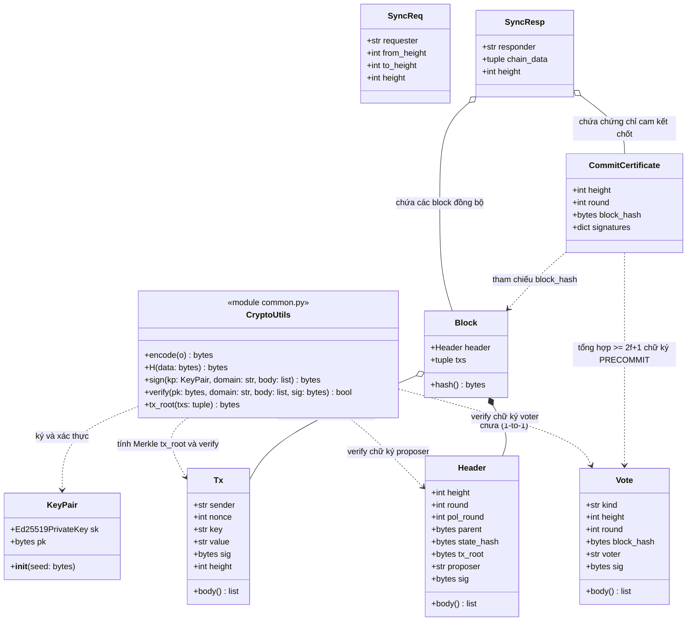
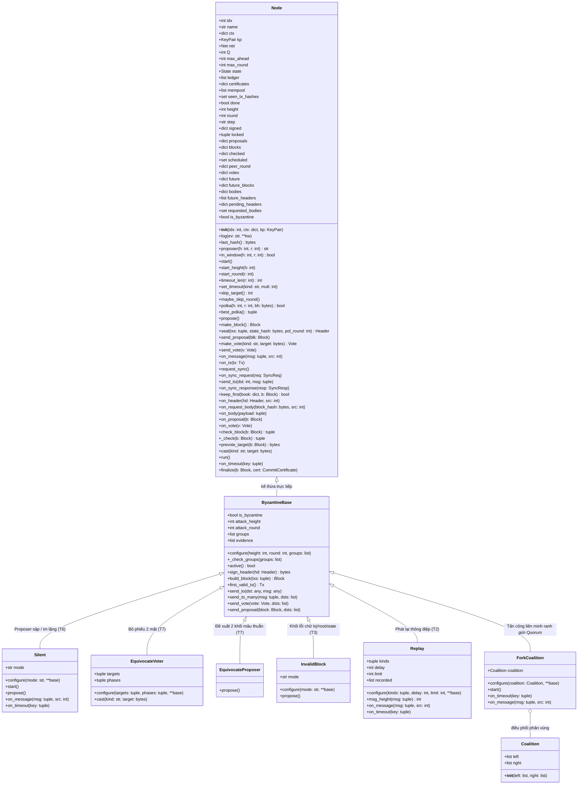
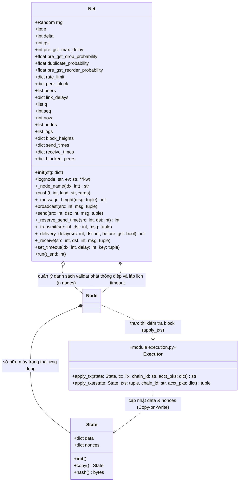
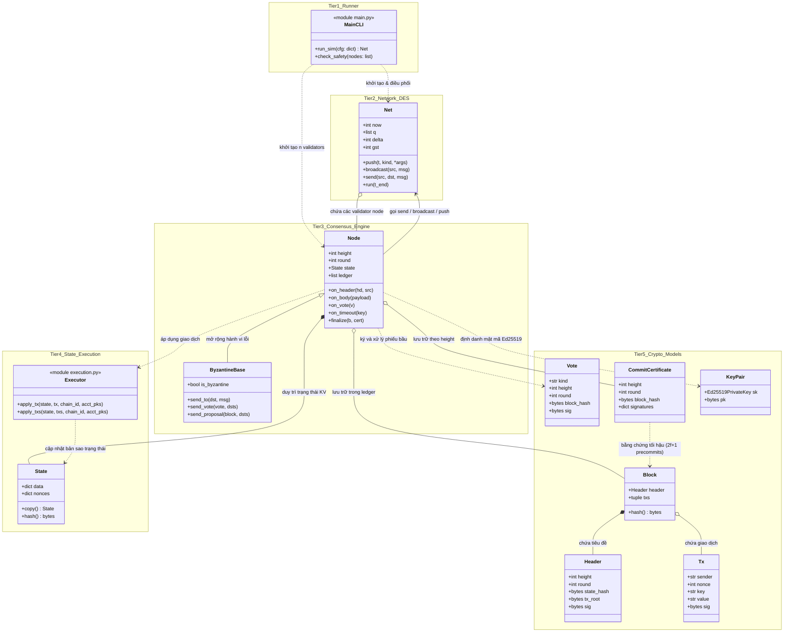

# BỘ SƠ ĐỒ LỚP CHI TIẾT HỆ THỐNG BLOCKCHAIN LAYER 1
## Tendermint BFT Consensus Engine & Discrete Event Simulation (DES)

Tài liệu này cung cấp đầy đủ và chính xác 100% các sơ đồ lớp (UML Class Diagrams) của hệ thống Blockchain Layer 1 theo cấu trúc mã nguồn trong thư mục `Workspace/src/`. Hệ thống được thiết kế theo mô hình hướng đối tượng kết hợp kiến trúc hướng sự kiện (Event-Driven Architecture) với 4 cụm sơ đồ chính:

1. **Sơ đồ Data Models & Cryptography (`src/common.py`)**
2. **Sơ đồ Consensus Engine & Byzantine Fault Injection (`src/node.py`, `src/byzantine.py`)**
3. **Sơ đồ Network Simulation & State Machine Execution (`src/sim.py`, `src/execution.py`)**
4. **Sơ đồ Kiến trúc Tổng thể Hệ thống 5 Lớp (System Architecture)**

---

## 1. SƠ ĐỒ DATA MODELS & CRYPTOGRAPHY (`src/common.py`)

Cụm mô hình dữ liệu định nghĩa các thực thể cốt lõi bất biến (Immutable Data Transfer Objects - `@dataclass(frozen=True)`), đảm bảo tính toàn vẹn thông qua chữ ký số Ed25519 và phân tách miền (Domain Separation).

### Đặc điểm thiết kế & Tính đúng đắn của Data Models:
- **`Block.hash()`**: Chỉ băm các trường nội dung cốt lõi `[height, parent, state_hash, tx_root]`. Không băm `round`, `pol_round`, `proposer` để đảm bảo cùng một nội dung khối khi đề xuất lại ở các round sau vẫn giữ nguyên mã định danh `block_hash`.
- **`Domain Separation`**:
  - `Tx.sig`: Ký với miền `"TX:" + chain_id`.
  - `Header.sig`: Ký với miền `"HEADER:" + chain_id`.
  - `Vote.sig`: Ký với miền `"VOTE:" + chain_id`.
  - Chống tuyệt đối tấn công giả mạo hoặc phát lại chéo ngữ cảnh (Cross-protocol Replay).
- **`CommitCertificate`**: Gom tối thiểu $Q = 2f + 1$ chữ ký `PRECOMMIT` hợp lệ. Đóng vai trò là bằng chứng mật mã (Finality Proof) cho giao thức bắt kịp dữ liệu (`Catch-up Sync`).

---

## 2. SƠ ĐỒ CONSENSUS ENGINE & BYZANTINE FAULT INJECTION (`src/node.py`, `src/byzantine.py`)

Cụm đồng thuận cài đặt cỗ máy trạng thái Tendermint BFT với 7 quy tắc vàng. Cây phân cấp Byzantine kế thừa toàn diện từ `Node` nhằm kiểm thử khả năng chịu lỗi và an toàn mạng.

### Các quy tắc Tendermint được hiện thực trong `Node`:
1. **Rule 1 & 2 (Không ký 2 phiếu)**: `signed[(h, r, kind)]` đảm bảo mỗi validator chỉ ký duy nhất 1 lần cho mỗi giai đoạn.
2. **Rule 3 (Thẩm định khối toàn diện)**: Hàm `_check(b)` kiểm tra chữ ký proposer, hash khối cha `b.header.parent == self.last_hash()`, Merkle root `tx_root`, và tính hợp lệ của mọi transaction.
3. **Rule 4 (Khóa khối - Lock Rule)**: Khi quan sát thấy $\ge Q$ phiếu `PREVOTE` cho một block $B \neq \text{NIL}$, node lập tức khóa vào block đó (`self.locked = (B, round)`).
4. **Rule 5 (Mở khóa / Đổi mục tiêu - Unlock Rule)**: Node bị khóa ở block $A$ chỉ được phép prevote cho block $B \neq A$ nếu thấy Polka ($\ge Q$ prevote cho $B$) ở một vòng `pol_round > self.locked[1]`.
5. **Rule 6 (Đúng ngữ cảnh)**: Loại bỏ các thông điệp ngoài cửa sổ trượt `in_window(h, r)` hoặc sai `chain_id`.
6. **Rule 7 (Chống đếm 2 lần & Phát hiện Equivocation)**: Bỏ qua phiếu bầu lặp lại từ cùng một validator; ghi nhận log `EQUIVOCATION` nếu nhận được 2 phiếu mâu thuẫn trong cùng slot.

---

## 3. SƠ ĐỒ NETWORK SIMULATION & EXECUTION (`src/sim.py`, `src/execution.py`)

Cụm mô phỏng mạng biến cố rời rạc (DES) điều phối thời gian ảo, mô phỏng mạng bán đồng bộ (GST, rớt gói, trễ tin, đảo thứ tự, DoS Rate Limiting), kết hợp với Máy trạng thái ứng dụng Key-Value Copy-on-Write.

### Đặc tính nổi bật của Tầng Mô phỏng & Thực thi:
- **Đồng hồ ảo (`now`) & Priority Queue (`heapq`)**: Mạng vận hành bằng biến cố rời rạc không dùng `sleep()`, đảm bảo mô phỏng siêu nhanh và tất định 100% (T8).
- **Mô hình Bán đồng bộ (Partial Synchrony)**:
  - Trước $GST$: Rớt gói ngẫu nhiên (`pre_gst_drop_probability`), trễ lớn (`pre_gst_max_delay`), đảo thứ tự tin (`pre_gst_reorder_probability`).
  - Sau $GST$: Giao vận tin cậy với cận trễ cố định $\Delta$ (`delta`).
- **Phòng vệ DoS (Mục 6 đề bài)**:
  - `Outbound Rate Limiting`: Cửa sổ trượt hoãn gửi các gói vượt định mức `max_messages` qua sự kiện `SEND_READY`.
  - `Inbound Peer Blocking`: Chặn các peer spam dồn dập trong thời gian `duration`, tự động `UNBLOCK` sau đó.
- **Thực thi Nguyên tử (Atomic Execution)**: Hàm `apply_txs` sử dụng `state.copy()`. Bất kỳ lỗi nonce (`bad_nonce`), chữ ký (`bad_tx_sig`), hoặc phân quyền (`not_owner`) đều hủy toàn bộ thay đổi.

---

## 4. SƠ ĐỒ KIẾN TRÚC TỔNG THỂ HỆ THỐNG 5 LỚP (FULL ARCHITECTURE)

Sơ đồ thể hiện bức tranh toàn cảnh và mối quan hệ phụ thuộc giữa 5 tầng module:

---

## 5. BẢNG ĐỐI CHIẾU THIẾT KẾ ĐỐI VỚI 8 KỊCH BẢN KIỂM THỬ T1 - T8

| Mã Test | Kịch Bản Kiểm Thử | Các Lớp & Phương Thức Chính Tham Gia | Cơ Chế Bảo Đảm Tính Đúng Đắn |
| :---: | :--- | :--- | :--- |
| **T1** | **Normal Run (No Faults)** | `Node.start_height()`, `Node.propose()`, `Node.on_vote()`, `Node.finalize()` | 8 node hoàn thành 5 block tại Round 0; cùng `state_hash` cuối cùng. |
| **T2** | **Duplicate & Reordered** | `Net._transmit()`, `Node.on_vote()`, `Node.seen_tx_hashes`, `byzantine.Replay` | **Rule 7** bỏ qua phiếu lặp lại; mempool deduplicate $O(1)$; không đếm 2 lần. |
| **T3** | **Invalid Signatures** | `common.verify()`, `byzantine.InvalidBlock`, `execution.apply_tx()` | Ghi log `bad_header_sig`, `bad_vote_sig`, `bad_tx_sig`; từ chối ngay ở cổng vào. |
| **T4** | **Replay Tx Nonce** | `execution.apply_tx()`, `Node.mempool`, `Node.seen_tx_hashes` | Chốt chặn `tx.nonce == current_nonce + 1`; từ chối phát lại với mã `bad_nonce`. |
| **T5** | **Pre-GST Drops & Delays** | `Net.run()`, `Net._delivery_delay()`, `Node.on_timeout()`, `Node.locked` | **Rule 4 & 5 (Lock & Unlock)** giữ vững Safety: không bao giờ phân nhánh khối. |
| **T6** | **Silent Proposer** | `byzantine.Silent`, `Node.on_timeout("PROPOSE")`, `Node.start_round()` | Hết giờ chờ đề xuất, validator bỏ phiếu `NIL`, tăng round và chốt khối ở Round 1. |
| **T7** | **Byzantine Equivocation** | `byzantine.EquivocateVoter`, `byzantine.EquivocateProposer`, `Node.Q` | Định lý giao điểm Quorum ($2f + 1$ với $n \ge 3f + 1$) ngăn chặn 2 khối chốt ở cùng height. |
| **T8** | **Determinism** | `Net.rng`, `Net.push()`, `common.encode()`, `State.hash()` | Cùng seed PRNG và cơ chế mã hóa tất định tạo log và state hash trùng khớp từng byte. |

