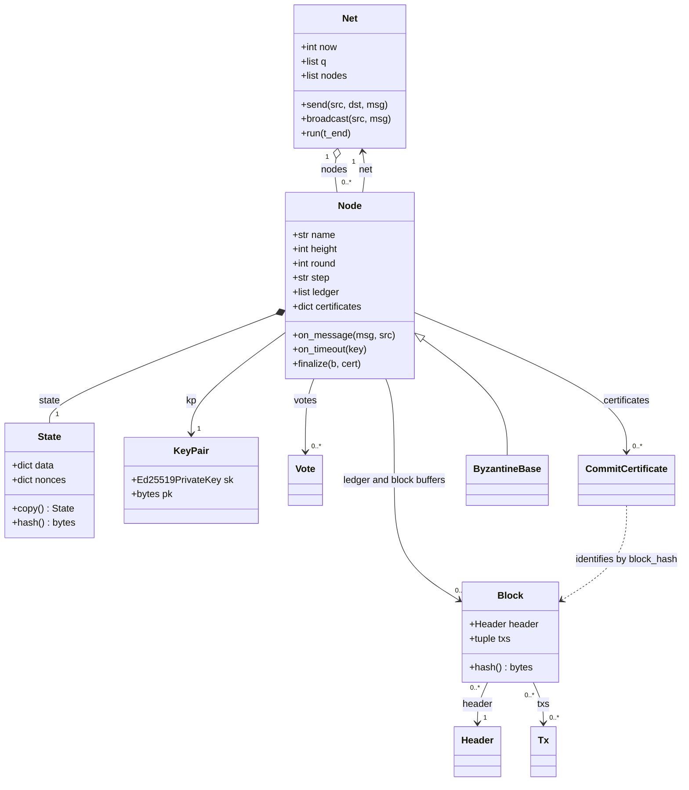
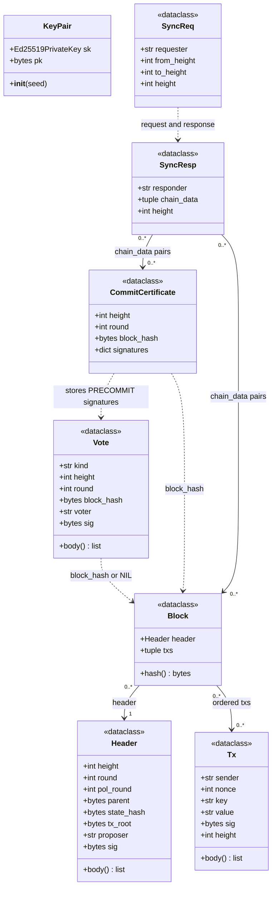
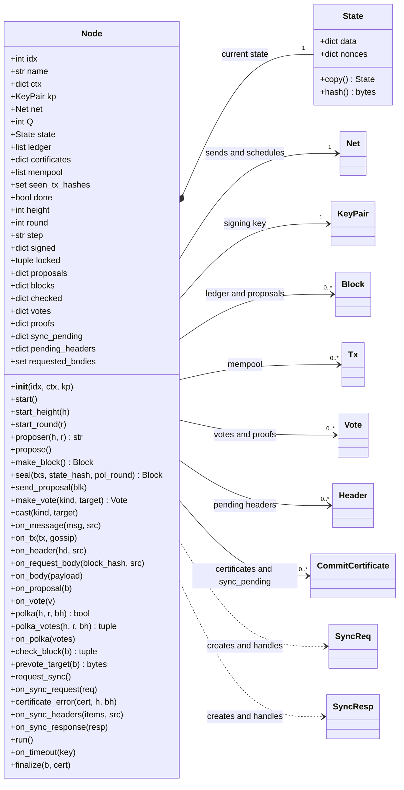
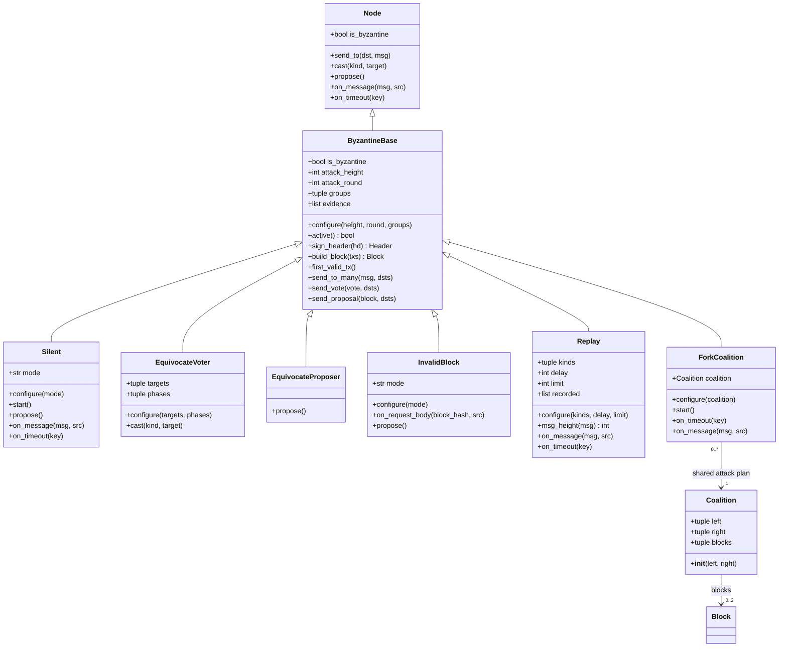
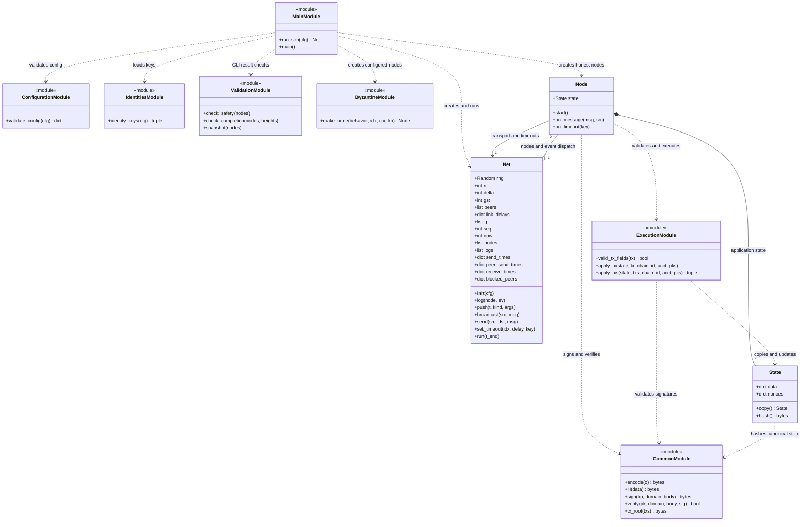
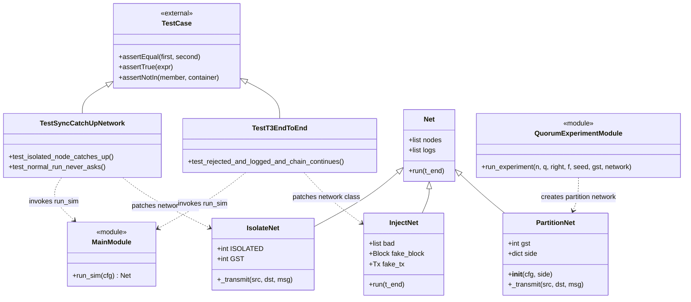

# Sơ đồ lớp — Blockchain Layer 1

Các sơ đồ đối chiếu với mã nguồn hiện tại trong `Workspace/src/` và các lớp mạng phục vụ E2E trong `Workspace/tests/e2e/`. Bộ sơ đồ 1–5 bao phủ 19 lớp cấp cao nhất của phần triển khai; mỗi sơ đồ chọn mức chi tiết theo mục đích đọc, không liệt kê toàn bộ phương thức nội bộ.

## Cách đọc và sử dụng

- `A <|-- B`: B kế thừa A.
- `A --> B`: A giữ tham chiếu tới B; nhãn cạnh ghi tên trường hoặc vai trò.
- `A o-- B`: A quản lý tập đối tượng B (aggregation).
- `A *-- B`: B là trạng thái riêng thuộc A (composition).
- `A ..> B`: A sử dụng B hoặc liên hệ qua dữ liệu, không nhất thiết giữ đối tượng B.
- `1`, `0..*`: số lượng đối tượng tại đầu quan hệ. Bội số phản ánh cấu trúc dữ liệu, không thay thế ràng buộc cấu hình của runner.
- `<<module>>` và `<<external>>` phân biệt module hàm và lớp thư viện ngoài với lớp của dự án.
- Dấu `+` biểu diễn khả năng truy cập trong Python; dấu gạch dưới ở tên phương thức giữ quy ước nội bộ của mã nguồn. Chữ ký được rút gọn, bỏ mặc định và một số `**kwargs`. Kiểu trả về được ghi khi hữu ích.

Xem trực tiếp các khối Mermaid trên trình xem Markdown hỗ trợ Mermaid, hoặc mở từng file `.mmd` trong [diagrams/](diagrams/). Với báo cáo ngắn, dùng sơ đồ **1** cho thiết kế tổng quan hoặc sơ đồ **6** cho phần testing; các sơ đồ chi tiết có thể đặt ở phụ lục.

## 1. Tổng quan các lớp chính

Nguồn: `Workspace/src/node.py`, `sim.py`, `execution.py`, `common.py`, `byzantine.py`.

Sơ đồ rút gọn phù hợp chèn vào phần thiết kế của báo cáo. Node giữ trạng thái riêng, tham chiếu mạng và lưu các block/chứng nhận đã chốt.

File riêng: [01-overview.mmd](diagrams/01-overview.mmd).

## 2. Mô hình dữ liệu và khóa mật mã

Nguồn: `Workspace/src/common.py`.

Bảy lớp dữ liệu dùng `@dataclass(frozen=True)`. Các trường dict bên trong vẫn có thể thay đổi; frozen không có nghĩa là bất biến sâu. `height` của Tx là property luôn trả về 0 để hỗ trợ log. Quan hệ với block qua hash là phụ thuộc, không phải tham chiếu trực tiếp tới đối tượng.

File riêng: [02-data-models.mmd](diagrams/02-data-models.mmd).

## 3. Validator và trạng thái đồng thuận

Nguồn: `Workspace/src/node.py`, `execution.py`, `common.py`.

Chọn các thuộc tính và phương thức chính, không liệt kê mọi helper. Mempool là list, context là dict và proof POLKA là tập Vote trong dict; không có lớp Mempool, Context hay PolkaCertificate riêng. `seal()` trả về Block, không phải Header.

File riêng: [03-consensus.mmd](diagrams/03-consensus.mmd).

## 4. Cây kế thừa và phối hợp Byzantine

Nguồn: `Workspace/src/byzantine.py`.

Các phương thức trong lớp con là những hook được ghi đè hoặc bổ sung. ByzantineBase kế thừa `send_to()` từ Node. ForkCoalition phục vụ thí nghiệm quorum, dùng chung Coalition giữa nhiều node; không phải thành phần bắt buộc của mô phỏng chuẩn.

File riêng: [04-byzantine.mmd](diagrams/04-byzantine.mmd).

## 5. Mạng mô phỏng, thực thi và điểm vào chương trình

Nguồn: `Workspace/src/sim.py`, `execution.py`, `main.py`, `configuration.py`, `identities.py`, `validation.py`.

Các hộp mang stereotype `module` biểu diễn hàm cấp module để làm rõ phụ thuộc; chúng không phải lớp Python. Các sự kiện nằm trong list/heap `Net.q`, không có lớp Event riêng. Net gọi các hook của Node, còn Node gọi API gửi tin và timeout của Net.

File riêng: [05-network-execution.mmd](diagrams/05-network-execution.mmd).

## 6. Các lớp hỗ trợ kiểm thử end-to-end

Nguồn: `Workspace/tests/e2e/test_sync_catchup.py`, `test_t3_invalid_signatures.py`, `test_quorum_boundary.py`.

Sơ đồ minh họa các lớp test và lớp mạng chèn lỗi thực tế, không phải danh sách đầy đủ mọi test case. Hai test class dùng mock.patch để thay Net trong `src.main` rồi gọi hàm `run_sim()`. PartitionNet được runner thí nghiệm quorum khởi tạo riêng. Assertion nằm trong test method hoặc các hàm hỗ trợ; không có lớp Assertion/Scenario riêng.

File riêng: [06-e2e-testing.mmd](diagrams/06-e2e-testing.mmd).

## Các chi tiết cần giữ đúng khi viết báo cáo

- `tx_root(txs)` là SHA-256 của danh sách `[tx.body(), tx.sig]` đã mã hóa, theo đúng thứ tự giao dịch; implementation hiện tại không dựng cây Merkle.
- `Block.hash()` băm `[height, parent, state_hash, tx_root]`; round, pol_round và proposer không thuộc định danh nội dung block.
- `CommitCertificate.signatures` lưu ánh xạ tên validator → chữ ký PRECOMMIT, không chứa danh sách đối tượng Vote. POLKA dùng các phiếu PREVOTE, là cơ chế khác.
- `Node.Q = 2 * f + 1`. Runner chuẩn kiểm tra `n = 3f + 1`, `n >= 8`; thí nghiệm quorum có runner riêng cho điều kiện ngoài giả định.
- `KeyPair` giữ khóa ký; các hàm encode/hash/sign/verify là hàm trong `common.py`. Không có lớp CryptoUtils thật.
- `State` có data/nonces và copy/hash. Các hàm `apply_tx`, `apply_txs` thuộc module `execution.py`, không phải phương thức của State hay lớp Executor.
- Các mô hình dữ liệu có thể được dùng lại giữa các block/node; vì thế quan hệ từ Block tới Header/Tx dùng association, không áp đặt quyền sở hữu độc quyền.
- File `blockchain.py` ở root là khung PoW với các hàm chưa triển khai, không nằm trong luồng Tendermint do `run_sim()` chạy, nên không đưa vào các sơ đồ hệ thống này.

