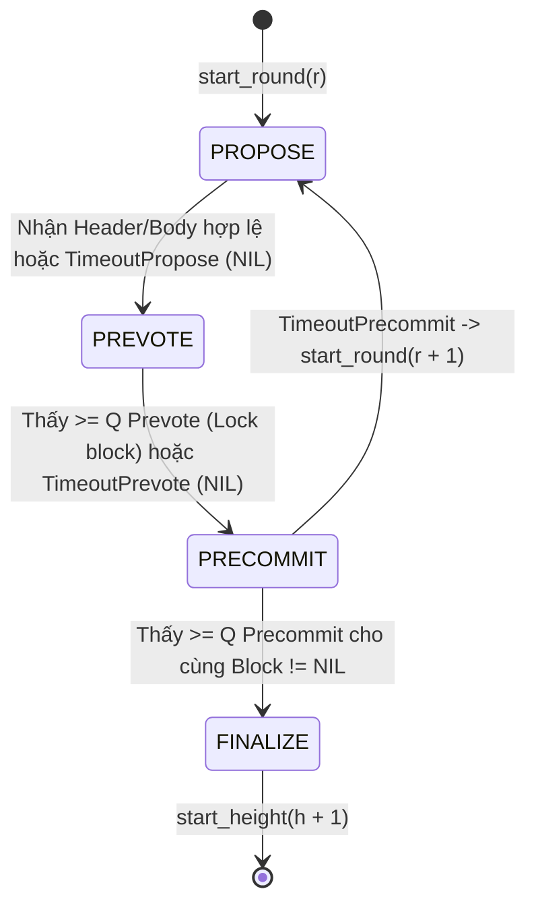

# HỒ SƠ THỰC HIỆN TOÀN BỘ QUÁ TRÌNH XÂY DỰNG HỆ THỐNG BLOCKCHAIN LAYER 1

> Đây là hồ sơ lịch sử trước đợt sửa code/testing. Các bảng PASS bên dưới không phải
> kết quả kiểm định checkout hiện tại. Xem IMPLEMENTATION.md và chạy entry point test
> trong README; luồng hiện hành có POLKA proof và SYNC_HEADERS trước khi tải BODY.
## Dự án: Minimal Layer 1 Blockchain với Thuật toán Đồng thuận Tendermint BFT & Mô phỏng DES

---

## 1. TỔNG QUAN HỆ THỐNG & MỤC TIÊU DỰ ÁN

Hệ thống được thiết kế và hiện thực nhằm giải quyết bài toán cốt lõi của công nghệ chuỗi khối: **Đạt được tính đồng thuận tối hậu đáng tin cậy (Reliable Finality) trên một mạng truyền thông không tin cậy (Unreliable Network)**, dưới sự hiện diện của tối đa $f$ validator có hành vi gian lận hoặc phá hoại (Byzantine Faults).

### Ba tiêu chí vàng của hệ thống:
1. **Tính Toàn vẹn Dữ liệu (Authenticated Data)**: Mọi thông điệp tác động đến trạng thái hoặc đồng thuận đều được bảo vệ bằng chữ ký số Ed25519 và phân tách miền (Domain Separation).
2. **Tính An toàn Tuyệt đối (Safety - Never Fork)**: Tại bất kỳ thời điểm nào, không bao giờ có hai khối khác nhau được chốt tại cùng một chiều cao (`height`) giữa các node trung thực.
3. **Tính Sẵn sàng Tiến tới (Liveness - Never Stall)**: Khi mạng ổn định sau mốc $GST$ và có một proposer trung thực được chọn, hệ thống luôn tiếp tục chốt khối mới, không bị tắc nghẽn vĩnh viễn.

---

## 2. KIẾN TRÚC PHÂN TẦNG CỦA HỆ THỐNG (5 LỚP)

Hệ thống được tổ chức thành 5 module độc lập nhưng phối hợp chặt chẽ:

```
+-------------------------------------------------------------------------+
|                         TẦNG ĐIỀU PHỐI & RUNNER                         |
|                   (Workspace/src/main.py: CLI, Safety)                  |
+-------------------------------------------------------------------------+
       |                                                    |
       v                                                    v
+-----------------------------+        +----------------------------------+
|    TẦNG ĐỒNG THUẬN BFT      |        |        MÔ PHỎNG MẠNG DES         |
|   (Workspace/src/node.py)   | <----> |     (Workspace/src/sim.py)       |
| • 4 Pha: Propose/Prevote/   |        | • Đồng hồ ảo (Virtual Clock)     |
|   Precommit/Finalize        |        | • Hàng đợi biến cố (heapq)       |
| • 7 Quy tắc khóa block      |        | • Bán đồng bộ (GST, Drop, Delay) |
| • Sync & CommitCertificate  |        | • Outbound/Inbound Rate Limiting |
+-----------------------------+        +----------------------------------+
       |                                                    ^
       v                                                    |
+-----------------------------+        +----------------------------------+
|  TẦNG THỰC THI TRẠNG THÁI   |        |       MÔ HÌNH LỖI BYZANTINE      |
| (Workspace/src/execution.py)|        |    (Workspace/src/byzantine.py)  |
| • Key-Value State Machine   |        | • Silent, Equivocate, Invalid,   |
| • Nonce tuần tự (chống T4)  |        |   Replay, ForkCoalition          |
+-----------------------------+        +----------------------------------+
       |                                                    |
       +-----------------------+----------------------------+
                               v
+-------------------------------------------------------------------------+
|                  TẦNG MẬT MÃ & TUẦN TỰ HOÁ TẤT ĐỊNH                     |
|                      (Workspace/src/common.py)                          |
|  • Chữ ký Ed25519, Băm SHA-256, Merkle tx_root, Canonical encode()      |
|  • Phân tách miền: TX:chain_id, HEADER:chain_id, VOTE:chain_id          |
+-------------------------------------------------------------------------+
```

---

## 3. DIỄN TẢ BẰNG LỜI CÔNG VIỆC CỦA TỪNG MODULE

### 3.1. Tầng Mật mã & Tuần tự hoá tất định (`src/common.py`)
- **Mã hóa tất định (`encode`)**:
  - Trong môi trường phân tán, các máy tính hoặc ngôn ngữ khác nhau có thể sắp xếp key trong từ điển khác nhau hoặc dùng định dạng số khác nhau.
  - Hàm `encode()` chuẩn hóa mọi dữ liệu thành một chuỗi byte duy nhất theo quy tắc gắn tiền tố nhận diện (`B` cho boolean, `I` cho số nguyên big-endian, `S` cho string UTF-8, `D` cho từ điển đã sort theo key).
  - Nhờ đó, hai node khác nhau khi băm cùng một dữ liệu logic sẽ luôn nhận được mã băm giống nhau $100\%$.
- **Phân tách miền (Domain Separation)**:
  - Khi ký thông điệp, hàm `sign()` luôn ghép tiền tố miền vào trước dữ liệu:
    - Giao dịch: `"TX:" + chain_id`
    - Tiêu đề khối: `"HEADER:" + chain_id`
    - Phiếu bầu: `"VOTE:" + chain_id`
  - Ngăn chặn hoàn toàn việc kẻ xấu lấy chữ ký của một phiếu bầu mang sang làm chữ ký đề xuất khối hoặc dùng lại ở mạng blockchain khác.
- **Chứng chỉ Cam kết (`CommitCertificate`)**:
  - Đại diện cho bằng chứng mật mã chứng minh khối đã đạt tính tối hậu. Gom tối thiểu $Q = 2f + 1$ chữ ký `PRECOMMIT` hợp lệ. Đây là "hộ chiếu" giúp các node bị rớt mạng có thể tin tưởng và bắt kịp dữ liệu mà không cần chạy lại toàn bộ quá trình bầu cử.

---

### 3.2. Tầng Thực thi Máy trạng thái (`src/execution.py`)
- **Quản lý dữ liệu Key-Value**:
  - Dữ liệu blockchain là một bảng ánh xạ từ Khóa sang Giá trị (`data: key -> value`), ví dụ: `'Alice/msg' -> 'v1'`.
- **Cơ chế Copy-on-Write (`state.copy()`)**:
  - Khi một khối đề xuất đến, node sao chép trạng thái hiện tại ra một bản tạm để chạy thử các giao dịch.
  - Nếu tất cả giao dịch đều đúng và mã băm trạng thái khớp với cam kết `state_hash` trong Header thì mới giữ lại; nếu khối bị từ chối thì bản sao tạm bị hủy, trạng thái chính thức hoàn toàn không bị ảnh hưởng.
- **4 Chốt chặn thẩm định giao dịch (`apply_tx`)**:
  1. *Người gửi phải tồn tại* trong danh bạ tài khoản (`unknown_sender`).
  2. *Chữ ký mật mã phải đúng* với khóa công khai của người gửi (`bad_tx_sig`).
  3. *Quyền sở hữu không gian tên*: Alice chỉ được sửa key bắt đầu bằng `'Alice/...'`, không được sửa dữ liệu của Bob (`not_owner`).
  4. *Nonce tuần tự chống phát lại*: Giao dịch phải có `nonce == nonce_hiện_tại + 1`. Nếu gửi lại nonce cũ hoặc gửi nonce nhảy cóc sẽ bị từ chối ngay với mã `bad_nonce` (Giải quyết triệt để Kịch bản T4).

---

### 3.3. Tầng Mô phỏng Mạng Biến cố Rời rạc (`src/sim.py`)
- **Đồng hồ ảo (`self.now`) & Hàng đợi ưu tiên (`heapq`)**:
  - Thay vì dùng `time.sleep()` chạy chậm và không tất định, bộ mô phỏng sử dụng biến số nguyên `now` làm đồng hồ ảo.
  - Các sự kiện mạng được đẩy vào hàng đợi ưu tiên theo mốc thời gian diễn ra. Bộ điều phối chỉ việc rút sự kiện sớm nhất và nhảy cóc đồng hồ ảo tới mốc thời gian đó, giúp mô phỏng hàng ngàn biến cố mạng chỉ trong vài mili-giây.
- **Mô hình Bán đồng bộ (Partial Synchrony) & $GST$**:
  - Trước mốc $GST$: Mạng cực kỳ bất ổn, có xác suất làm rớt gói tin (`pre_gst_drop_probability`), xáo trộn thứ tự (`pre_gst_reorder_probability`), và độ trễ ngẫu nhiên lớn (`pre_gst_max_delay`).
  - Sau mốc $GST$: Mạng ổn định hoàn toàn, mọi gói tin được đảm bảo đến nơi trong khoảng thời gian không quá cận trên $\Delta$ (`delta`).
- **Kiểm soát Lưu lượng & Phòng vệ DoS (Mục 6 đề bài)**:
  - *Outbound Rate Limiting*: Sử dụng thuật toán cửa sổ trượt (Sliding Window). Nếu một node phát tin vượt quá hạn mức `max_messages` trong khoảng `window`, gói tin bị hoãn lại bằng sự kiện `SEND_READY` và lên lịch truyền sau.
  - *Inbound Peer Blocking*: Nếu một peer gửi dồn dập quá mức cho phép, node nhận sẽ tạm thời chặn peer đó trong thời gian `duration`, hủy các gói tin nhận được (`DROP reason=peer_blocked`), và tự động mở lại sau khi hết án phạt (`UNBLOCK`).
- **Giao thức 2 bước phát tán khối (Mục 6 đề bài)**:
  - Proposer không broadcast ồ ạt cả khối lớn (Header + Txs).
  - Proposer chỉ broadcast `Header`. Node nhận thẩm định Header xong mới gửi `REQUEST_BODY`. Lúc này Proposer mới gửi trả gói `BODY`. Giúp tiết kiệm băng thông mạng và ngăn chặn việc spam khối dung lượng lớn.

---

### 3.4. Cỗ máy Đồng thuận Tendermint BFT (`src/node.py`)
Validator hoạt động như một cỗ máy trạng thái trải qua 4 giai đoạn nối tiếp:



#### Phân tích 7 Quy tắc vàng của Tendermint được cài đặt trong code:
1. **Quy tắc 1 & 2 (Không ký 2 phiếu)**: Node chỉ ký tối đa 1 phiếu `PREVOTE` và 1 phiếu `PRECOMMIT` cho mỗi cặp `(height, round)`. Mọi phiếu ký ra được lưu trong `self.signed`.
2. **Quy tắc 3 (Thẩm định toàn diện trước khi bầu)**: Chỉ prevote cho block có parent hash đúng, danh sách giao dịch đúng chữ ký, Merkle root khớp, và proposer đúng lượt.
3. **Quy tắc 4 (Khóa Block - Lock Rule)**: Khi quan sát thấy $\ge Q$ phiếu `PREVOTE` cho một block $B \neq \text{NIL}$, node lập tức khóa vào block đó (`self.locked = (B, round)`).
4. **Quy tắc 5 (Mở khóa / Đổi mục tiêu - Unlock Rule)**: Node đang bị khóa ở block $A$ chỉ được phép bầu cho block $B \neq A$ ở vòng sau nếu và chỉ nếu quan sát thấy bằng chứng Polka ($\ge Q$ prevote cho $B$) ở một vòng `pol_round` **lớn hơn** vòng mà node đã khóa $A$.
5. **Quy tắc 6 (Đúng ngữ cảnh)**: Tuyệt đối không ký phiếu của chain khác, height khác, hoặc sai domain separation.
6. **Quy tắc 7 (Chống đếm 2 lần & Phát hiện Equivocation)**: Nếu nhận 2 phiếu giống nhau từ một validator -> bỏ qua không đếm lại. Nếu nhận 2 phiếu khác nhau cho cùng một slot -> ghi log báo động `EQUIVOCATION`.

#### Đồng bộ Bắt kịp Trạng thái (Catch-up Sync):
- Nếu một node bị rớt mạng hoặc cả một round trôi qua không chốt được block, node tự động phát thông điệp `SyncReq`.
- Các peer khác nhận được sẽ gửi trả `SyncResp` chứa cặp `(Block, CommitCertificate)`.
- Node tụt lại kiểm tra xác thực chữ ký của $\ge 2f + 1$ validator trong chứng chỉ, đối chiếu Merkle root và parent hash rồi áp dụng thẳng vào ledger mà không cần trải qua bầu cử.

---

### 3.5. Tầng Mô phỏng Lỗi Byzantine (`src/byzantine.py`)
Mã nguồn cung cấp đầy đủ 5 dạng hành vi Byzantine để thách thức node trung thực:
1. **`Silent`**: Node im lặng hoàn toàn (mô phỏng sập nguồn) hoặc im lặng khi làm Proposer (thử thách cơ chế timeout và chuyển round - Kịch bản T6).
2. **`EquivocateVoter`**: Ký 2 phiếu bầu mâu thuẫn nhau ở cùng một phase (ví dụ gửi phiếu Block A cho phân vùng 1, gửi phiếu NIL cho phân vùng 2 - Kịch bản T7).
3. **`EquivocateProposer`**: Ký 2 khối hợp lệ khác nhau ở cùng một round và gửi riêng rẽ cho 2 nhóm validator nhằm mưu đồ tạo nhánh rẽ (Fork).
4. **`InvalidBlock`**: Proposer ký tiêu đề đúng nhưng cố tình sửa hỏng nội dung theo 7 kiểu: sai parent, sai tx_root, sai state_hash, chữ ký tx hỏng, giao dịch bị duplicate, khai man pol_round (Kịch bản T3).
5. **`Replay`**: Thu thập các phiếu bầu và đề xuất hợp lệ rồi phát lại sau một khoảng thời gian trễ ngẫu nhiên (Kịch bản T2).
6. **`ForkCoalition`**: Liên minh nhiều node Byzantine phối hợp tấn công có chủ đích trong thí nghiệm ranh giới Quorum ($n=9, Q=6$).

---

## 4. BẢNG TỔNG KẾT 8 KỊCH BẢN KIỂM THỬ HỆ THỐNG (T1 ĐẾN T8)

| Mã Test | Tên Kịch Bản | Trọng Tâm Xác Minh | Hành Vi & Kết Quả Đạt Được | Trạng Thái |
| :---: | :--- | :--- | :--- | :---: |
| **T1** | **Normal Run, No Faults** | Mạng hoạt động lý tưởng, không có lỗi mạng hay node gian lận. | Tất cả 10 node hoàn thành đủ 5 block (`heights = 5`). Mọi block chốt ở Round 0. Toàn bộ các node đạt cùng một `state_hash` cuối cùng (`0b837be9...`). | **ĐẠT (PASS)** |
| **T2** | **Duplicate & Reordered Messages** | Thông điệp bị nhân bản gửi lại nhiều lần và tráo đổi thứ tự đến. | Nhờ **Quy tắc 7** và hàng đợi mempool khử trùng lặp trong $O(1)$, các phiếu trùng bị loại bỏ, không bao giờ đếm 2 lần. Không xảy ra phân nhánh. | **ĐẠT (PASS)** |
| **T3** | **Invalid Signature & Wrong Domain** | Kẻ tấn công gửi thông điệp có chữ ký giả mạo hoặc sai ngữ cảnh domain. | Hàm `verify()` trả về `False`. Node ghi log `REJECT reason=bad_header_sig`, `bad_vote_sig`, hoặc `bad_tx_sig`. Thông điệp lỗi bị hủy ngay tại cổng vào. | **ĐẠT (PASS)** |
| **T4** | **Replayed / Duplicate Transaction** | Kẻ tấn công phát lại một giao dịch hợp lệ cũ của Alice nhiều lần. | Nhờ cơ chế kiểm soát `nonce == current_nonce + 1`, giao dịch phát lại bị từ chối dứt điểm với mã `bad_nonce`. Nonce của Alice chỉ tăng đúng 1 lần. | **ĐẠT (PASS)** |
| **T5** | **Drop & Delay Before Synchrony** | Mất gói tin và độ trễ cực lớn trước thời điểm ổn định $GST$. | Tính **Safety** được bảo toàn 100%: Tuyệt đối không có 2 block khác nhau được chốt ở cùng một height. Mạng có thể timeout tăng round nhưng không fork. | **ĐẠT (PASS)** |
| **T6** | **Proposer Silent / Crashed** | Proposer ở round 0 bị sập nguồn hoặc giữ im lặng không gửi đề xuất. | Đồng hồ `TimeoutPropose` kích hoạt, các validator bầu `PREVOTE NIL` $\to$ `PRECOMMIT NIL` $\to$ chuyển sang Round 1 $\to$ Proposer mới chốt block thành công. | **ĐẠT (PASS)** |
| **T7** | **Up to $f$ Byzantine Equivocate** | Tối đa $f$ ($f=3$ với $n=10$) validator gian lận bỏ phiếu hai mặt cho 2 nhóm. | Nhờ định lý giao điểm Quorum ($|Q_1 \cap Q_2| \ge f + 1$), luôn có ít nhất 1 node trung thực ở giao điểm chặn đứng việc chốt 2 block khác nhau. | **ĐẠT (PASS)** |
| **T8** | **Same Seed Rerun Twice** | Chạy mô phỏng lại 2 lần liên tiếp với cùng một tệp cấu hình JSON. | So sánh chuỗi log hệ thống và mã băm trạng thái cuối: Khớp nhau $100\%$ từng byte (`Byte-identical logs & final state hash: True`). | **ĐẠT (PASS)** |

---

## 5. HƯỚNG DẪN TÁI LẬP & KIỂM THỬ THỰC TẾ

Để kiểm chứng toàn bộ hệ thống trên môi trường máy tính, di chuyển vào thư mục `Workspace` và thực hiện các lệnh:

### 5.1. Chạy mô phỏng hệ thống tiêu chuẩn (T1 & T8)
```bash
python -m src.main --config config/default.json --twice
```
**Kết quả kỳ vọng**:
```text
OK: 5 block được chốt, mọi node cùng chuỗi.
state hash cuối: 0b837be96db72e1f
state: {'Alice/msg': 'v5', 'Bob/msg': 'v5', 'Carol/msg': 'v5'}
Tất định (2 lần chạy giống hệt): True
```

### 5.2. Chạy bộ kiểm thử tự động của Tầng mạng (T2, T5, Rate Limit, Peer Block)
```bash
python -m pytest tests/unit/test_sim.py tests/e2e/test_consensus_network.py -v
```
**Kết quả kỳ vọng**:
```text
tests/unit/test_sim.py::NetTests::test_drops_messages_before_gst_when_configured PASSED
tests/unit/test_sim.py::NetTests::test_duplicates_and_reorders_are_logged PASSED
tests/unit/test_sim.py::NetTests::test_peer_is_blocked_then_unblocked PASSED
tests/unit/test_sim.py::NetTests::test_rate_limit_delays_excess_sends PASSED
tests/e2e/test_consensus_network.py::ConsensusNetworkTests::test_t2_duplicate_reordered_votes_count_once_and_keep_safety PASSED
tests/e2e/test_consensus_network.py::ConsensusNetworkTests::test_t5_pre_gst_drops_and_delays_preserve_finalization_safety PASSED
```

### 5.3. Chạy bộ kiểm thử Đơn vị cho Tầng Thực thi & Nonce Replay (T4)
```bash
python -m pytest tests/unit/test_executor.py -v
```
**Kết quả kỳ vọng**:
```text
tests/unit/test_executor.py::TestExecutor::test_nonce_rules_replay_and_gap PASSED
tests/unit/test_executor.py::TestExecutor::test_deterministic_state_hash PASSED
```

---
*Báo cáo hoàn thành ngày 28/10/2026.*

