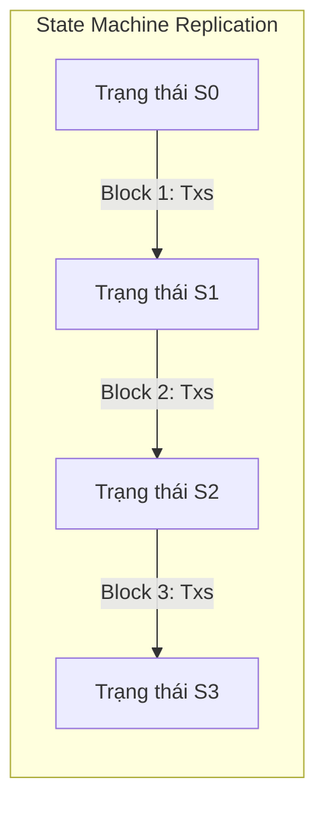
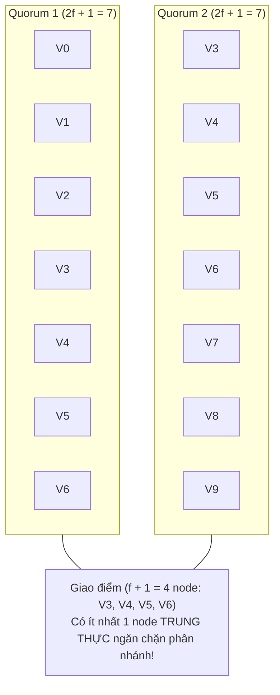

# Chuyên Đề 01: Kiến Thức Nền Tảng Blockchain Layer 1 & Mô Hình BFT

Tài liệu này cung cấp nền tảng lý thuyết cốt lõi để bạn hiểu được **tại sao dự án này được thiết kế như vậy**, các giả định toán học đằng sau con số $n = 3f + 1$, và cách giải quyết bài toán đồng thuận phân tán.

---

## 1. Bản Chất Của Blockchain Layer 1

### 1.1. State Machine Replication (SMR)
Về mặt khoa học máy tính, Blockchain Layer 1 là một giải pháp hiện thực hóa bài toán **Nhân bản máy trạng thái (State Machine Replication - SMR)** trên môi trường mạng phân tán:
- **State Machine (Máy trạng thái)**: Gồm trạng thái ban đầu ($S_0$), tập hợp các đầu vào (giao dịch - transactions $T$), và hàm chuyển đổi tất định:
  $$\text{apply}(S, T) \to S'$$
- **Replication (Nhân bản)**: Một tập hợp gồm $n$ máy tính độc lập (các validator node) cùng lưu trữ một bản sao của máy trạng thái.
- **Mục tiêu**: Bất kể mạng có bị trễ, mất gói, hay có node bị tấn công, tất cả các node trung thực phải chuyển trạng thái qua một chuỗi các bước **giống hệt nhau**:
  $$S_0 \xrightarrow{\text{Block}_1} S_1 \xrightarrow{\text{Block}_2} S_2 \xrightarrow{\text{Block}_3} \dots$$



### 1.2. Sổ Cái Bất Biến (Append-only Ledger)
- Dữ liệu lịch sử đã chốt (`finalized`) chỉ có thể thêm vào ở cuối chuỗi (`append-only`), không bao giờ được sửa đổi hoặc xóa bỏ.
- Mỗi block liên kết chặt chẽ với block cha (`parent_hash`), tạo thành một cấu trúc chuỗi khối chống giả mạo bằng hàm băm mật mã.

---

## 2. Môi Trường Mạng Phân Tán & Giả Định Đồng Bộ

Trong một hệ thống phân tán, các validator giao tiếp qua mạng Internet - một môi trường không đáng tin cậy. Lý thuyết phân tán chia mạng thành 3 mô hình chính:

| Tiêu chí | Mạng đồng bộ (Synchronous) | Mạng bất đồng bộ (Asynchronous) | Mạng bán đồng bộ (Partially Synchronous) |
| :--- | :--- | :--- | :--- |
| **Độ trễ thông điệp** | Có chặn trên xác định trước ($\Delta$). Nếu gửi tại $t$, chắc chắn nhận trước $t + \Delta$. | Không có chặn trên. Thông điệp có thể trễ vô hạn (nhưng cuối cùng vẫn tới). | Trước mốc thời gian $GST$ (Global Stabilization Time), trễ tùy ý. Sau $GST$, độ trễ $\le \Delta$. |
| **Đặc điểm thực tế** | Quá lạc quan, dễ bị sập nếu mạng bị tấn công DDoS hoặc đứt cáp. | Quá bi quan, không thể thiết kế thuật toán vừa nhanh vừa an toàn (Định lý FLP). | **Mô hình thực tế nhất**, phản ánh đúng bản chất Internet và được áp dụng trong Lab này. |

### Mô hình mạng trong dự án này:
- Hệ thống hoạt động theo mô hình **Partially Synchronous**:
  - Giai đoạn đầu: Tin nhắn có thể bị trễ, xáo trộn thứ tự (`reordered`), gửi trùng lặp (`duplicated`), hoặc bị rơi tạm thời (`dropped`).
  - Sau thời điểm ổn định ($GST$): Tin nhắn giữa các node trung thực được chuyển giao trong một khoảng thời gian chặn trên $\Delta$ (`delta` trong file `config/default.json`).

---

## 3. Mô Hình Lỗi Byzantine & Định Lý $n \ge 3f + 1$

### 3.1. Phân biệt Lỗi Crash (Fail-Stop) vs Lỗi Byzantine (BFT)
1. **Crash Fault (Lỗi dừng hoạt động)**: Node bị sập nguồn, mất mạng, tắt máy. Node dừng hoàn toàn, không gửi tin nhắn sai lệch.
2. **Byzantine Fault (Lỗi phản bội/tùy ý)**: Node bị tin tặc chiếm quyền điều khiển, hoặc do phần mềm bị bug nghiêm trọng. Node có thể:
   - Im lặng không trả lời (giả vờ chết).
   - Gửi các thông điệp mâu thuẫn cho các node khác nhau (gọi là **Equivocation** hay gian lận hai mặt).
   - Đề xuất block không hợp lệ, chứa giao dịch giả mạo.
   - Gửi lại các thông điệp cũ (Replay attack).

> **Giả định an toàn mật mã**: Kẻ tấn công Byzantine dù tinh vi đến đâu cũng **không thể** giả mạo chữ ký số của node trung thực và **không thể** tìm ra xung đột của hàm băm SHA-256.

```
                    ┌──────────────────────────────────────────────┐
                    │               Validator Set (n)              │
                    ├──────────────────────────────┬───────────────┤
                    │     Node trung thực (≥ 2f+1) │ Byzantine (≤f)│
                    └──────────────────────────────┴───────────────┘
```

---

### 3.2. Chứng Minh Toán Học: Tại Sao $n \ge 3f + 1$?

Giả sử hệ thống có $n$ validator, trong đó có tối đa $f$ node là Byzantine:

1. **Khả năng liveness (hệ thống không bị treo)**:
   - Trong trường hợp xấu nhất, $f$ node Byzantine có thể giữ im lặng hoàn toàn.
   - Do đó, một validator trung thực chỉ có thể kỳ vọng nhận được tối đa $n - f$ phản hồi để đưa ra quyết định mà không phải chờ đợi vô hạn.
   - Vậy kích thước của một đa số phiếu (Quorum $Q$) tối đa không được vượt quá:
     $$Q \le n - f$$

2. **Khả năng safety (không bao giờ chốt 2 block mâu thuẫn)**:
   - Trong $n - f$ phiếu mà validator nhận được, có thể có tối đa $f$ phiếu đến từ các node Byzantine (những node này nói dối hoặc gửi hai mặt).
   - Số phiếu thực sự đáng tin cậy từ các node trung thực là:
     $$(n - f) - f = n - 2f$$
   - Để ngăn chặn một quyết định mâu thuẫn khác cũng có thể tập hợp đủ đa số ở một nhánh rẽ khác, số phiếu của các node trung thực trong nhóm này phải chiếm thế đa số tuyệt đối so với số node Byzantine còn lại:
     $$n - 2f > f \iff n > 3f \iff n \ge 3f + 1$$

#### Ví dụ trực quan với cấu hình trong dự án:
- Mở file [default.json](file:///e:/DISK_D/MDUY/Nam4/4.1%20Blockchain/Lab1/Blockchain_lab_1/config/default.json):
  ```json
  "n": 10,
  "f": 3
  ```
  Thỏa mãn chính xác đẳng thức: $10 = 3 \times 3 + 1$.
- Quorum cần thiết để thông qua một quyết định:
  $$Q = 2f + 1 = 2 \times 3 + 1 = 7$$

#### Định lý Giao Điểm Quorum (Quorum Intersection):
Nếu lấy hai nhóm Quorum bất kỳ $Q_1$ và $Q_2$ (mỗi nhóm gồm $2f + 1$ validator):
$$|Q_1 \cap Q_2| = |Q_1| + |Q_2| - |Q_1 \cup Q_2| \ge (2f + 1) + (2f + 1) - (3f + 1) = f + 1$$
- Giao của 2 nhóm luôn có ít nhất $f + 1$ node.
- Vì toàn mạng có tối đa $f$ node Byzantine, nên trong $f + 1$ node chung này **chắc chắn luôn có ít nhất:**
  $$(f + 1) - f = 1 \text{ node TRUNG THỰC!}$$
- Vì node trung thực tuân thủ luật đồng thuận (không bao giờ ký hai phiếu khác nhau ở cùng một vòng), nên hai Quorum không bao giờ có thể chốt hai block khác nhau!



---

## 4. Hai Thuộc Tính Sống Còn: Safety vs Liveness

Trong lý thuyết hệ thống phân tán, mọi giao thức đồng thuận đều xoay quanh hai tính chất:

### 4.1. Safety (Tính an toàn - "Nothing bad happens")
- **Định nghĩa**: Không bao giờ có hai block khác nhau được chốt (`finalized`) ở cùng một chiều cao (`height`) bởi các node trung thực.
- **Hệ quả**: Không có hiện tượng phân nhánh chuỗi (hard fork / double spending).
- **Yêu cầu đề bài Lab 01**: Safety phải được đảm bảo **trong mọi hoàn cảnh**, kể cả khi mạng bị lag tồi tệ, mất gói hoặc có $f$ node Byzantine tích cực phá hoại.

### 4.2. Liveness (Tính sống còn - "Something good eventually happens")
- **Định nghĩa**: Hệ thống không bị rơi vào trạng thái bế tắc (deadlock). Các giao dịch hợp lệ từ người dùng cuối cùng sẽ được đưa vào block và chốt thành công.
- **Hệ quả**: Chuỗi khối liên tục tăng chiều cao ($height \to height + 1 \to \dots$).
- **Yêu cầu đề bài Lab 01**: Liveness chỉ được đảm bảo sau khi mạng đã ổn định ($GST$) và chọn được một Proposer trung thực.

### 4.3. Định lý Bất Khả Thi FLP (Fischer - Lynch - Paterson, 1985)
> **Định lý FLP**: Trong một mạng hoàn toàn bất đồng bộ (Asynchronous Network), không thể tồn tại một thuật toán đồng thuận tất định nào có thể đồng thời đảm bảo cả **Safety** và **Liveness** nếu chỉ cần có **duy nhất 1 node bị lỗi crash**.

#### Triết lý thiết kế của Tendermint:
- **Ưu tiên Safety lên trên hết**: Nếu mạng phân mảnh hoặc các node không đạt được đồng thuận, hệ thống chấp nhận tạm dừng tiến trình (hy sinh Liveness tạm thời) chứ **tuyệt đối không bao giờ chốt 2 block mâu thuẫn** (bảo vệ Safety).
- Khi mạng phục hồi, cơ chế **Timeout lũy tiến** sẽ giúp các node đồng bộ lại vòng quay và tiếp tục chốt block.
