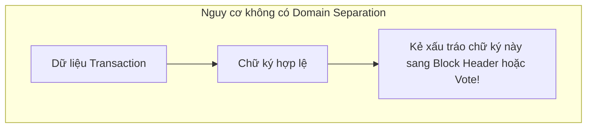
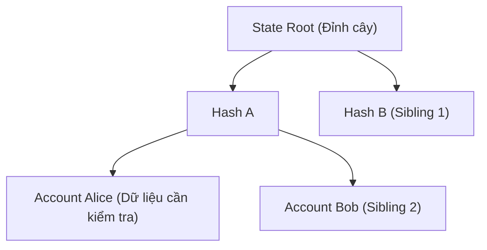

# Chuyên Đề 02: Mật Mã Học, Phân Tách Miền & Mã Hóa Tất Định

Tài liệu này giải thích chi tiết tầng mật mã học (`Cryptography layer`) và cơ chế đảm bảo tính tất định (`Determinism`) được hiện thực hóa trong [common.py](file:///e:/DISK_D/MDUY/Nam4/4.1%20Blockchain/Lab1/Blockchain_lab_1/src/common.py).

---

## 1. Mật Mã Khóa Bất Đối Xứng: Chuẩn Ed25519

Trong blockchain, danh tính (`identity`) của người dùng và validator được xác định bằng cặp khóa mật mã:
- **Khóa bí mật (Private Key / Secret Key - $sk$)**: Giữ bí mật, dùng để ký thông điệp (`sign`).
- **Khóa công khai (Public Key - $pk$)**: Công khai cho toàn mạng, dùng để kiểm tra tính hợp lệ của chữ ký (`verify`).

### 1.1. Tại sao dự án chọn Ed25519 thay vì Secp256k1 (Bitcoin) hay RSA?
- **Hiệu năng vượt trội**: Ed25519 (dựa trên đường cong Edwards kép Twisted Edwards Curve 25519) cho tốc độ ký và kiểm tra chữ ký nhanh gấp nhiều lần RSA và nhanh hơn đáng kể so với ECDSA `secp256k1`.
- **Kích thước nhỏ gọn**: Khóa công khai chỉ đúng **32 bytes**, chữ ký chỉ **64 bytes**.
- **Miễn nhiễm Timing Attacks**: Quá trình tính toán không phụ thuộc vào dữ liệu đầu vào, ngăn ngừa tấn công kênh kề (side-channel attacks).

### 1.2. Hiện thực trong [common.py: Lớp KeyPair](file:///e:/DISK_D/MDUY/Nam4/4.1%20Blockchain/Lab1/Blockchain_lab_1/src/common.py#L42-L47)
```python
class KeyPair:
    def __init__(self, seed: bytes):
        # Tạo private key 32 bytes từ hàm băm SHA-256 của seed
        self.sk = Ed25519PrivateKey.from_private_bytes(H(seed))
        # Xuất public key dạng raw bytes (32 bytes)
        self.pk = self.sk.public_key().public_bytes(
            serialization.Encoding.Raw, serialization.PublicFormat.Raw)
```
- Cơ chế khởi tạo từ `seed` giúp mô phỏng có thể tái lập (`reproducible`) chính xác cùng một tập khóa validator qua các lần chạy test khác nhau.

---

## 2. Phân Tách Miền Ký (Domain Separation)

### 2.1. Nguy cơ của Tấn công tráo đổi ngữ cảnh (Cross-Context / Replay Attack)
Giả sử hệ thống ký trực tiếp lên mảng byte của thông điệp mà không có tiền tố ngữ cảnh:
1. Người dùng ký một giao dịch chuyển dữ liệu: `body = ["Alice", 1, "Alice/msg", "hello"]`.
2. Một validator ác ý có thể cố tình định dạng lại các byte này để đóng giả thành một **Block Header** hoặc một lá phiếu **Vote** hợp lệ vì chữ ký toán học hoàn toàn khớp!
3. Hoặc một thông điệp hợp lệ ở mạng thử nghiệm (`testnet`) có thể bị gửi sang mạng chính (`mainnet`) để thực thi trái phép nếu hai mạng dùng chung định dạng.



### 2.2. Giải pháp: Thêm tiền tố định danh miền (Domain Prefix)
Mỗi loại thông điệp bắt buộc phải được gắn một tiền tố miền duy nhất đi kèm `chain_id`:
- **Giao dịch**: `"TX:" + chain_id` (Ví dụ: `TX:lab01`)
- **Tiêu đề khối**: `"HEADER:" + chain_id` (Ví dụ: `HEADER:lab01`)
- **Lá phiếu đồng thuận**: `"VOTE:" + chain_id` (Ví dụ: `VOTE:lab01`)

### 2.3. Hiện thực trong [common.py: Hàm sign & verify](file:///e:/DISK_D/MDUY/Nam4/4.1%20Blockchain/Lab1/Blockchain_lab_1/src/common.py#L49-L60)
```python
def sign(kp: KeyPair, domain: str, body) -> bytes:
    # Ghép domain đã encode với body đã encode trước khi ký
    return kp.sk.sign(encode(domain) + encode(body))

def verify(pk: bytes, domain: str, body, sig: bytes) -> bool:
    try:
        # Bên nhận bắt buộc phải đối chiếu đúng domain và đúng body
        Ed25519PublicKey.from_public_bytes(pk).verify(
            sig, encode(domain) + encode(body))
        return True
    except (InvalidSignature, ValueError):
        return False
```
> [!IMPORTANT]
> Nhờ cơ chế này, một chữ ký tạo ra cho `TX:lab01` **vĩnh viễn không thể** được xác minh thành công dưới ngữ cảnh `HEADER:lab01` hay `VOTE:lab01`, dập tắt hoàn toàn các cuộc tấn công replay xuyên tầng!

---

## 3. Mã Hóa Tất Định (Deterministic Serialization / Canonical Encoding)

### 3.1. Tại sao không dùng JSON, Protobuf hay Pickle?
Trong blockchain, các node phải băm (`hash`) các đối tượng dữ liệu phức tạp (giao dịch, tiêu đề, trạng thái). Hàm băm mật mã SHA-256 có **hiệu ứng tuyết lở (Avalanche Effect)**: chỉ cần khác biệt **1 bit duy nhất**, giá trị băm sẽ biến đổi hoàn toàn.

Nếu dùng các thư viện thông thường:
- `json.dumps()`: Không đảm bảo thứ tự các khóa trong dictionary, khoảng trắng (` `) có thể khác nhau giữa các hệ điều hành (Windows vs Linux).
- `pickle` (Python): Chứa thông tin nhị phân đặc thù của phiên bản Python, tiềm ẩn lỗ hổng bảo mật nghiêm trọng.
- `Protobuf`: Khá phức tạp và yêu cầu schema biên dịch cồng kềnh.

**Giải pháp**: Tự định nghĩa một chuẩn mã hóa nhị phân tất định (Canonical Serialization), đảm bảo: **Cùng một giá trị logic luôn sinh ra một chuỗi byte duy nhất trên mọi máy tính!**

---

### 3.2. Giải phẫu hàm `encode(o)` trong [common.py](file:///e:/DISK_D/MDUY/Nam4/4.1%20Blockchain/Lab1/Blockchain_lab_1/src/common.py#L16-L35)

Hàm `encode()` sử dụng tiền tố 1 byte kiểu (`Type Tag`) theo sau là dữ liệu định dạng chuẩn:

| Kiểu dữ liệu Python | Type Tag | Định dạng nhị phân chi tiết | Giải thích kỹ thuật |
| :--- | :---: | :--- | :--- |
| `None` | `b"N"` | `b"N"` (1 byte duy nhất) | Đại diện cho giá trị rỗng |
| `bool` | `b"B"` | `b"B\x01"` (True) hoặc `b"B\x00"` (False) | 2 bytes cố định |
| `int` | `b"I"` | `b"I" + struct.pack(">q", o)` | 9 bytes: `>q` nghĩa là **Big-Endian Signed 64-bit Integer** |
| `str` | `b"S"` | `b"S" + struct.pack(">I", len(d)) + utf8_bytes` | `>I` là độ dài chuỗi dạng 32-bit unsigned int, theo sau là chuỗi UTF-8 |
| `bytes / bytearray` | `b"Y"` | `b"Y" + struct.pack(">I", len(o)) + raw_bytes` | Tiền tố độ dài 32-bit + mảng byte thô |
| `list / tuple` | `b"L"` | `b"L" + struct.pack(">I", len(o)) + b"".join(...)` | Mã hóa từng phần tử và nối lại |
| `dict` | `b"D"` | `b"D" + struct.pack(">I", len(items)) + ...` | **Cực kỳ quan trọng**: Gọi `sorted(o.items())` để sắp xếp khóa theo thứ tự từ điển trước khi nối byte! |

#### Đoạn code xử lý Dictionary bảo đảm tính tất định:
```python
if isinstance(o, dict):
    # Sắp xếp các cặp key-value theo thứ tự tăng dần
    items = sorted(o.items())
    return b"D" + struct.pack(">I", len(items)) + b"".join(
        encode(k) + encode(v) for k, v in items)
```
Dù hai node chèn các cặp key-value vào dictionary theo thứ tự nào, hàm `sorted()` sẽ đưa về cùng một trật tự chuẩn xác trước khi tính hash!

---

## 4. Hàm Băm SHA-256 & Cấu Trúc Cây Merkle

### 4.1. Hàm băm SHA-256
Trong [common.py: dòng 37](file:///e:/DISK_D/MDUY/Nam4/4.1%20Blockchain/Lab1/Blockchain_lab_1/src/common.py#L37-L38):
```python
def H(data: bytes) -> bytes:
    return hashlib.sha256(data).digest()
```
- Đầu vào: Mảng byte tùy ý.
- Đầu ra: Đúng 32 bytes (256 bits) không thể đảo ngược (one-way) và chống đụng độ (collision-resistant).

---

### 4.2. Tính toán `tx_root` trong Block Header
Trong [common.py: dòng 112](file:///e:/DISK_D/MDUY/Nam4/4.1%20Blockchain/Lab1/Blockchain_lab_1/src/common.py#L112-L113):
```python
def tx_root(txs) -> bytes:
    return H(encode([[t.body(), t.sig] for t in txs]))
```
- `tx_root` là giá trị băm cam kết toàn bộ danh sách giao dịch có trong block.
- Nếu bất kỳ giao dịch nào bị sửa đổi dù chỉ 1 ký tự, hoặc thứ tự thực thi bị tráo đổi, `tx_root` sẽ thay đổi ngay lập tức, khiến Block Header trở nên không hợp lệ.

---

### 4.3. Mở rộng từ Slide Bài Giảng: Merkle Patricia Trie & Merkle Proof
Trong các hệ thống thực tế như Ethereum hay Tendermint mở rộng (xem slide bài giảng trang 7-8):



- **Merkle Proof**: Khi một Light Client (ví dụ ứng dụng ví trên điện thoại) muốn biết Alice có bao nhiêu tiền, nó không cần tải toàn bộ cơ sở dữ liệu hàng trăm Gigabyte. Node đầy đủ (Full node) chỉ cần gửi:
  1. Dữ liệu của Alice (`Leaf1`).
  2. Các giá trị băm anh em trên đường dẫn (`Sibling 1`, `Sibling 2`).
- Light Client tự băm ngược từ dưới lên: nếu kết quả trùng khớp với `State Root` đã được ký bởi các validator trong Header, dữ liệu được chứng minh là chính xác $100\%$!
- Độ phức tạp bằng chứng: Chỉ tốn $O(\log N)$ thay vì $O(N)$.
