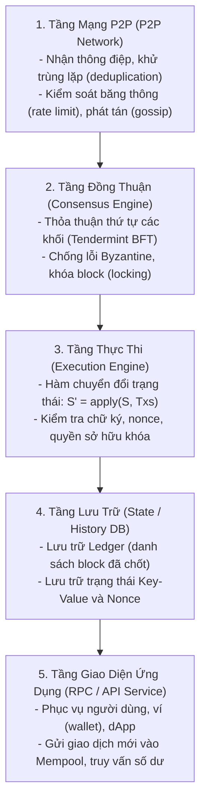
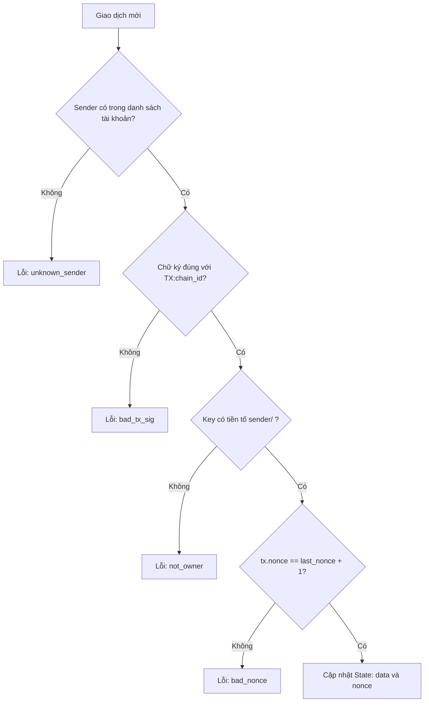

# Chuyên Đề 03: Kiến Trúc Node & Mô Hình Thực Thi Chuyển Trạng Thái

Tài liệu này phân tích cấu trúc bên trong của một Blockchain Node, vòng đời dữ liệu và mô hình thực thi trạng thái tất định được cài đặt trong [execution.py](file:///e:/DISK_D/MDUY/Nam4/4.1%20Blockchain/Lab1/Blockchain_lab_1/src/execution.py).

---

## 1. Kiến Trúc 5 Tầng Chuẩn Của Một Blockchain Node

Theo thiết kế hệ thống trong bài giảng lý thuyết (Slide trang 5-6), một Blockchain Node hoàn chỉnh gồm 5 tầng kiến trúc độc lập, phân tách rõ ràng trách nhiệm:



### Pipeline Xử Lý Khối (Processing Pipeline)
1. **Nhận thông điệp**: Node nhận Header / Block từ mạng ngang hàng qua sự kiện `MSG`.
2. **Xác thực Header**: Kiểm tra liên kết khối cha (`parent == last_hash`), người đề xuất hợp lệ (`proposer`), chữ ký header.
3. **Thực thi giao dịch**: Đưa block vào Execution Engine để chạy thử nghiệm các giao dịch.
4. **Cập nhật trạng thái**: Khi block đạt đủ số phiếu đồng thuận (Commit), cập nhật trạng thái chính thức và ghi vào sổ cái (`ledger.append(b)`).
5. **Phục vụ truy vấn**: Cập nhật đỉnh chuỗi (`head`) và cung cấp kết quả cho client.

---

## 2. Các Cấu Trúc Dữ Liệu Cốt Lõi

Trong [common.py](file:///e:/DISK_D/MDUY/Nam4/4.1%20Blockchain/Lab1/Blockchain_lab_1/src/common.py#L63-L110), các thực thể được đóng gói bằng `@dataclass(frozen=True)` để đảm bảo tính bất biến (không thể bị sửa đổi ngoài ý muốn sau khi khởi tạo):

### 2.1. Transaction (`Tx`)
Giao dịch thể hiện yêu cầu ghi/sửa dữ liệu của người dùng:
```python
@dataclass(frozen=True)
class Tx:
    sender: str   # Tên tài khoản gửi (ví dụ: "Alice")
    nonce: int    # Số thứ tự tuần tự giao dịch của tài khoản (1, 2, 3...)
    key: str      # Khóa dữ liệu muốn cập nhật (ví dụ: "Alice/msg")
    value: str    # Giá trị mới cần ghi (ví dụ: "hello")
    sig: bytes    # Chữ ký Ed25519 của sender trên body()
```
- `body()` trả về: `[sender, nonce, key, value]`.

### 2.2. Block Header (`Header`)
Tiêu đề khối chứa các cam kết mật mã cốt lõi:
```python
@dataclass(frozen=True)
class Header:
    height: int       # Chiều cao khối trong chuỗi (1, 2, 3...)
    round: int        # Vòng đồng thuận đạt được thỏa thuận (0, 1, 2...)
    parent: bytes     # Hash của block header liền trước
    state_hash: bytes # Hash cam kết trạng thái SAU KHI thực thi xong block này
    tx_root: bytes    # Hash cam kết toàn bộ danh sách giao dịch trong block
    proposer: str     # Tên validator đề xuất block
    sig: bytes        # Chữ ký của proposer trên header
```

### 2.3. Block (`Block`)
```python
@dataclass(frozen=True)
class Block:
    header: Header    # Tiêu đề khối
    txs: tuple = ()   # Tuple danh sách các giao dịch (đảm bảo thứ tự)

    def hash(self) -> bytes:
        # Băm của Block chính là băm của Header body
        return H(encode(self.header.body()))
```

### 2.4. Vote (`Vote`)
Lá phiếu đồng thuận do các validator phát ra trong quá trình biểu quyết:
```python
@dataclass(frozen=True)
class Vote:
    kind: str          # Loại phiếu: "PREVOTE" hoặc "PRECOMMIT"
    height: int        # Chiều cao khối
    round: int         # Vòng đồng thuận
    block_hash: bytes  # Hash của block được bầu (hoặc b"" nếu là phiếu NIL)
    voter: str         # Validator ký phiếu
    sig: bytes         # Chữ ký Ed25519 trên vote body
```

---

## 3. Máy Trạng Thái (State Machine) Trong [execution.py](file:///e:/DISK_D/MDUY/Nam4/4.1%20Blockchain/Lab1/Blockchain_lab_1/src/execution.py)

### 3.1. Cấu trúc Lớp `State`
Trạng thái của blockchain được mô hình hóa thành một kho lưu trữ Key-Value kết hợp quản lý Nonce:
```python
class State:
    def __init__(self):
        self.data = {}    # key -> value (dữ liệu ứng dụng)
        self.nonces = {}  # account -> nonce cuối cùng đã thực thi
```

#### Phương thức băm trạng thái tất định:
```python
def hash(self) -> bytes:
    return H(encode([sorted(self.data.items()), sorted(self.nonces.items())]))
```
- Các cặp key-value và nonces luôn được `sorted()` trước khi băm, đảm bảo mọi validator đều tính ra cùng một `state_hash` nếu có cùng trạng thái dữ liệu.

---

### 3.2. Cơ chế Thực Thi Giao Dịch: Hàm `apply_tx`
Hàm [apply_tx](file:///e:/DISK_D/MDUY/Nam4/4.1%20Blockchain/Lab1/Blockchain_lab_1/src/execution.py#L19-L32) thực hiện 4 bước kiểm tra an ninh nghiêm ngặt trước khi cập nhật dữ liệu:



1. **Xác định danh tính**: Kiểm tra `sender` có khóa công khai đăng ký trước hay không:
   ```python
   pk = acct_pks.get(tx.sender)
   if pk is None: return "unknown_sender"
   ```
2. **Xác minh chữ ký & Domain Separation**: Kiểm tra chữ ký bằng domain `TX:chain_id`:
   ```python
   if not verify(pk, "TX:" + chain_id, tx.body(), tx.sig):
       return "bad_tx_sig"
   ```
3. **Kiểm soát quyền sở hữu khóa (Access Control)**: Người dùng chỉ được sửa đổi khóa dữ liệu thuộc về mình (phải có tiền tố `sender/`):
   ```python
   if not tx.key.startswith(tx.sender + "/"):
       return "not_owner"
   ```
   *Ví dụ*: Alice chỉ có quyền sửa `Alice/message`, `Alice/balance`. Alice không thể sửa khóa `Bob/message`.
4. **Kiểm tra Nonce tuần tự (Chống Replay Attack)**:
   ```python
   if tx.nonce != state.nonces.get(tx.sender, 0) + 1:
       return "bad_nonce"
   ```
   *Tác dụng*: Một giao dịch đã được thực thi thì nonce của tài khoản đó đã tăng lên. Kẻ xấu lấy trộm giao dịch cũ gửi lại sẽ bị từ chối ngay vì sai nonce!
5. **Cập nhật trạng thái**:
   ```python
   state.data[tx.key] = tx.value
   state.nonces[tx.sender] = tx.nonce
   ```

---

### 3.3. Tính Nguyên Tố (Atomicity) & Kỹ Thuật Copy-on-Write: Hàm `apply_txs`
Một block chứa một chuỗi nhiều giao dịch. Nếu trong block có 10 giao dịch, nhưng giao dịch thứ 8 bị lỗi thì sao?
- Trong Blockchain, **một Block chỉ có hai trạng thái: hoặc thành công toàn bộ, hoặc bị từ chối hoàn toàn (All-or-Nothing)**.
- Hàm `apply_txs` áp dụng kỹ thuật **Copy-on-Write**:
```python
def apply_txs(state: State, txs, chain_id: str, acct_pks: dict):
    # Sao chép một bản sao trạng thái độc lập
    s = state.copy()
    for tx in txs:
        err = apply_tx(s, tx, chain_id, acct_pks)
        if err:
            # Nếu có bất kỳ lỗi nào, hủy bỏ ngay, không chạm vào state gốc!
            return None, err
    # Toàn bộ hợp lệ, trả về trạng thái mới
    return s, None
```

---

## 4. Các Vai Trò Node (Node Roles) & Chế Độ Đồng Bộ (Sync Modes)

Theo bài giảng lý thuyết (Slide trang 3, 4, 10, 12):

### 4.1. Phân loại các vai trò của Node trong mạng
| Loại Node | Lưu trữ dữ liệu | Cơ chế xác thực | Vai trò thực tế |
| :--- | :--- | :--- | :--- |
| **Full Node** | Trạng thái mới nhất + Block gần đây | Tự xác thực tất cả block | Validator, nhà vận hành mạng, sàn giao dịch |
| **Archival Node** | Toàn bộ lịch sử từ Genesis + mọi trạng thái cũ | Tự xác thực toàn bộ | Blockchain Explorer (Etherscan), dịch vụ phân tích dữ liệu |
| **Pruned Node** | Trạng thái mới nhất, cắt tỉa (xóa bớt) block cũ | Tự xác thực | Node cá nhân chạy trên thiết bị dung lượng thấp |
| **Light Client** | Chỉ lưu Block Header | Dựa vào Merkle Proof | Ứng dụng ví trên điện thoại (Metamask di động) |
| **Stateless Client**| Không lưu trạng thái | Xác thực qua nhân chứng (Witness) | Đề xuất nghiên cứu mở rộng Ethereum (Verkle Trees) |

### 4.2. Các Chế độ Đồng Bộ Dữ Liệu (Sync Modes)
Khi một node mới tham gia vào mạng hoặc khởi động lại:
1. **Full Sync (Replay all)**: Tải toàn bộ block từ block số 1 đến nay, chạy lại từng giao dịch. Mức độ an toàn cao nhất (Self-verified), nhưng tốc độ khởi động chậm nhất.
2. **Fast / Snap Sync**: Tải các Block Header, sau đó tải thẳng một bản chụp trạng thái (`State Snapshot`) tại một block gần nhất. Bỏ qua việc thực thi lại các block cũ trong quá khứ để vào mạng nhanh chóng.
3. **Checkpoint Sync**: Người vận hành cung cấp sẵn một mã hash đáng tin cậy của một block gần đây (`Trusted Anchor`), node bắt đầu đồng bộ và xác minh từ block đó trở đi.

---

## 5. Xử Lý Phân Nhánh (Reorganization) & Phục Hồi Lỗi (Crash Recovery)

### 5.1. Reorganization (Reorg)
Trong các mạng dùng luật chuỗi dài nhất (PoW Nakamoto Consensus), khi phát hiện nhánh chuỗi khác dài hơn và nặng hơn:
- Node phải **Rollback** trạng thái về tổ tiên chung gần nhất (`Common Ancestor`).
- Hủy bỏ các block ở nhánh cũ và thực thi lại các block ở nhánh mới (Slide trang 13).
> **Điểm khác biệt của Tendermint BFT**: Tendermint có tính chất **Instant Finality (Chốt tức thì)**. Một khi block đã được finalize, nó không bao giờ bị reorg! Vì vậy không bao giờ xảy ra rollback sau khi đã commit.

### 5.2. Crash Recovery & Write-Ahead Log (WAL)
Để chống mất dữ liệu khi mất điện hoặc máy chủ bị tắt đột ngột:
- Node ghi lại dự định và các lá phiếu đã ký vào **Nhật ký ghi trước (Write-Ahead Log - WAL)** trên ổ cứng trước khi gửi ra mạng.
- Khi khởi động lại, node đọc lại WAL để phục hồi chính xác trạng thái và lá phiếu đã ký, ngăn ngừa việc ký hai lần (Double Signing) vi phạm luật đồng thuận (Slide trang 14).
