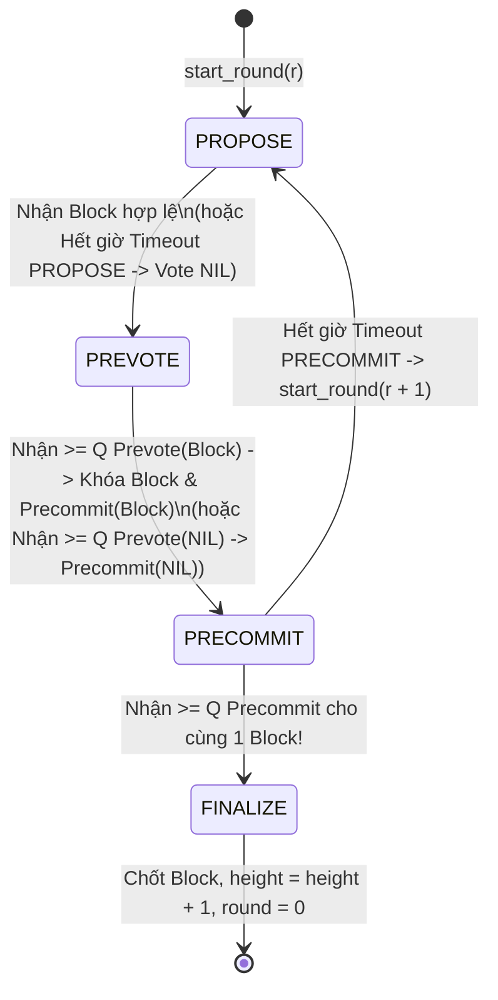

# Chuyên Đề 04: Thuật Toán Đồng Thuận Tendermint BFT & 7 Quy Tắc Vàng

Tài liệu này giải thích chi tiết động cơ đồng thuận **Tendermint BFT** - trái tim của dự án, được hiện thực hóa trong [node.py](file:///e:/DISK_D/MDUY/Nam4/4.1%20Blockchain/Lab1/Blockchain_lab_1/src/node.py).

---

## 1. Tổng Quan Kiến Trúc Đồng Thuận Tendermint

Tendermint là giao thức đồng thuận BFT (Byzantine Fault Tolerance) dựa trên cơ chế vòng lặp xoay vòng (Round-based), có tính chất **Instant Finality** (chốt khối tức thì, không bao giờ phân nhánh chuỗi nếu số node Byzantine $f < n/3$).

### 1.1. Các Khái Niệm Đo Lường Thời Gian Logic
- **Height ($h$)**: Chiều cao của blockchain (Block 1, Block 2, Block 3...). Mỗi height tương ứng với một block duy nhất được chốt vào sổ cái.
- **Round ($r$)**: Vòng thỏa thuận bên trong một height ($r = 0, 1, 2...$). Nếu round $0$ thất bại (do mạng lag hoặc leader bị sập), các node sẽ chuyển sang round $1, 2...$ cho đến khi chốt được block tại height đó.
- **Step**: Bước thực hiện trong một round: gồm `PROPOSE` $\to$ `PREVOTE` $\to$ `PRECOMMIT`.

```
Height 1: [Round 0: Thành công] ──────────────────────────────────────────► Finalize Block 1
Height 2: [Round 0: Timeout] ──► [Round 1: Timeout] ──► [Round 2: OK] ────► Finalize Block 2
Height 3: [Round 0: Thành công] ──────────────────────────────────────────► Finalize Block 3
```

### 1.2. Thuật Toán Chọn Leader (Proposer Selection)
Trong mỗi `(height, round)`, chỉ có duy nhất **một validator** được chỉ định làm Leader (Proposer) để đề xuất block.
Công thức trong [node.py: dòng 31-33](file:///e:/DISK_D/MDUY/Nam4/4.1%20Blockchain/Lab1/Blockchain_lab_1/src/node.py#L31-L33):
```python
def proposer(self, h, r):
    v = self.ctx["vals"]
    return v[(h + r) % len(v)]
```
- Thuật toán Round-Robin tất định xoay tua qua danh sách validator.
- Nếu Proposer ở round $r$ bị offline hoặc gian lận, mạng sẽ timeout và round $r + 1$ sẽ tự động chọn một Proposer khác!

---

## 2. Vòng Đời Một Round: Cỗ Máy Trạng Thái FSM



### Chi tiết các bước thực thi:

#### Bước 1: `PROPOSE` (Đề xuất khối)
- Nếu node là Proposer của `(height, round)`:
  1. Lấy các giao dịch hợp lệ từ `mempool` (tối đa `max_txs_per_block`).
  2. Thực thi thử nghiệm trên bản sao trạng thái (`s = state.copy()`) để tính `state_hash` sau khi áp dụng.
  3. Tính `tx_root` của danh sách giao dịch.
  4. Tạo `Header`, ký bằng private key với domain `HEADER:chain_id`.
  5. Đóng gói thành `Block` và gửi broadcast khắp mạng (`PROPOSAL`).
- Node bật đồng hồ đếm ngược `timeout_len(r)` cho bước `PROPOSE`.

#### Bước 2: `PREVOTE` (Bỏ phiếu sơ bộ)
- Node nhận `PROPOSAL` từ mạng. Node kiểm tra tính hợp lệ của block qua hàm `check_block(b)`.
- **Quy tắc bỏ phiếu**:
  - Nếu block hợp lệ VÀ (node chưa bị khóa block nào HOẶC block này chính là block node đang bị khóa): Node ký phiếu `PREVOTE` cho mã hash của block.
  - Ngược lại (block sai, hoặc hết giờ timeout `PROPOSE` mà chưa nhận được proposal hợp lệ): Node ký phiếu `PREVOTE` cho `NIL` (giá trị rỗng `b""`).

#### Bước 3: `PRECOMMIT` (Cam kết sơ bộ & Khóa Block)
- Node lắng nghe các phiếu `PREVOTE` từ các validator khác:
  - **Trường hợp 1**: Nếu gom được $\ge Q$ ($2f + 1$) phiếu `PREVOTE` cho cùng một block hash $t \ne \text{NIL}$:
    - **Hành động cực kỳ quan trọng**: Node tiến hành **Khóa block** đó lại:
      ```python
      self.locked = (t, r)
      ```
    - Ký phiếu `PRECOMMIT` cho block hash $t$.
  - **Trường hợp 2**: Nếu gom được $\ge Q$ phiếu `PREVOTE` cho `NIL`:
    - Ký phiếu `PRECOMMIT` cho `NIL`.
- Nếu gom được đủ $Q$ phiếu bất kỳ mà chưa có block nào đạt $\ge Q$, node kích hoạt timeout `PREVOTE`.

#### Bước 4: `FINALIZE` (Chốt khối chính thức)
- Bất kể node đang ở bước nào, nếu phát hiện gom được **$\ge Q$ phiếu `PRECOMMIT` cho cùng một block $t \ne \text{NIL}$** ở bất kỳ round nào của height hiện tại:
  - Block $t$ chính thức đạt trạng thái **Finalized**!
  - Node gọi hàm `finalize(b)`:
    1. Áp dụng vĩnh viễn các giao dịch vào `self.state`.
    2. Nối block vào sổ cái: `self.ledger.append(b)`.
    3. Xóa các giao dịch đã thực thi khỏi `self.mempool`.
    4. Tăng chiều cao chuỗi: `self.start_height(height + 1)` và đặt lại round về 0.

---

## 3. Phân Tích Chuyên Sâu 7 Quy Tắc Ký Phiếu & Khóa Block (Locking Rules)

Đề bài Lab 01 đặt ra **7 quy tắc bắt buộc** để đảm bảo tính Safety và Liveness. Dưới đây là đối chiếu trực tiếp giữa lý thuyết và từng dòng mã nguồn trong [node.py](file:///e:/DISK_D/MDUY/Nam4/4.1%20Blockchain/Lab1/Blockchain_lab_1/src/node.py):

---

### Quy tắc 1 & 2: Ký tối đa 1 phiếu PREVOTE và 1 phiếu PRECOMMIT cho mỗi `(height, round)`
> **Mục đích**: Chống gian lận hai mặt (Equivocation) từ validator. Một validator không bao giờ được phép ký 2 lá phiếu khác nhau ở cùng một vòng.

- **Mã nguồn trong [node.py: dòng 152-156](file:///e:/DISK_D/MDUY/Nam4/4.1%20Blockchain/Lab1/Blockchain_lab_1/src/node.py#L152-L156)**:
```python
def cast(self, kind, target):
    key = (self.height, self.round, kind)
    if key in self.signed:
        return  # Đã ký phiếu cho bước này rồi thì TUYỆT ĐỐI không ký lại!
    self.signed[key] = target
    ...
```

---

### Quy tắc 3: Chỉ chấp nhận và Prevote cho block hợp lệ toàn diện
> **Mục đích**: Đảm bảo không bao giờ đưa dữ liệu rác, sai quy tắc chuyển trạng thái hoặc block của kẻ mạo danh vào chuỗi.

- **Mã nguồn trong [node.py: dòng 136-149](file:///e:/DISK_D/MDUY/Nam4/4.1%20Blockchain/Lab1/Blockchain_lab_1/src/node.py#L136-L149)**:
```python
def _check(self, b):
    hd = b.header
    if hd.height != self.height: return False, "wrong_height"
    if hd.parent != self.last_hash(): return False, "bad_parent"
    if hd.tx_root != tx_root(b.txs): return False, "bad_tx_root"
    s, err = apply_txs(self.state, b.txs, self.ctx["chain_id"], self.ctx["acct_pks"])
    if err: return False, err
    if s.hash() != hd.state_hash: return False, "bad_state_hash"
    return True, ""
```
Node kiểm tra đầy đủ 5 tiêu chí:
1. `height` khớp với chiều cao hiện tại.
2. `parent` khớp với hash của đỉnh chuỗi hiện tại (`last_hash`).
3. `tx_root` khớp với cây băm danh sách giao dịch đính kèm.
4. Mọi giao dịch khi chạy thử bằng `apply_txs` đều hợp lệ (chữ ký đúng, quyền sở hữu đúng, nonce đúng).
5. `state_hash` trong header khớp $100\%$ với mã băm trạng thái sau khi thực thi thử!

---

### Quy tắc 4: Khóa Block khi quan sát thấy Quorum PREVOTE cho non-NIL block
> **Mục đích**: Bảo vệ Safety. Khi đã có đa số $\ge 2f + 1$ validator đồng ý với block $t$ ở bước Prevote, validator phải "khóa" lòng tin của mình vào block $t$ để không bị dụ dỗ bỏ phiếu cho block khác ở các vòng sau.

- **Mã nguồn trong [node.py: dòng 177-183](file:///e:/DISK_D/MDUY/Nam4/4.1%20Blockchain/Lab1/Blockchain_lab_1/src/node.py#L177-L183)**:
```python
for t, c in sorted(Counter(v.block_hash for v in pv.values()).items()):
    if c >= self.Q:
        if t != NIL and t in self.blocks and self.check_block(self.blocks[t]):
            self.locked = (t, r)  # KHÓA BLOCK t tại round r!
            self.cast("PRECOMMIT", t)
```

---

### Quy tắc 5: Quy tắc Mở khóa / Chuyển khóa (Unlocking Rule)
> **Mục đích**: Bảo vệ Liveness. Giả sử node đang bị khóa ở block $B$ tại round 0. Sang round 1, một Proposer mới đề xuất block $B'$. Khi nào node được phép bỏ phiếu Prevote cho block $B'$?

- **Điều kiện**: Node chỉ được Prevote cho $B'$ nếu nó quan sát thấy một **Quorum $\ge 2f + 1$ phiếu PREVOTE hợp lệ cho $B'$ ở một round muộn hơn** round mà nó đang bị khóa!
- **Mã nguồn trong [node.py: dòng 171](file:///e:/DISK_D/MDUY/Nam4/4.1%20Blockchain/Lab1/Blockchain_lab_1/src/node.py#L171)**:
```python
can = self.check_block(b) and (self.locked is None or self.locked[0] == bh)
self.cast("PREVOTE", bh if can else NIL)
```
*Ghi chú*: Trong phiên bản tối thiểu của Lab 01, nếu node đang bị khóa ở block khác (`self.locked[0] != bh`), node sẽ bỏ phiếu `NIL`, đảm bảo an toàn tuyệt đối không vi phạm khóa cũ.

---

### Quy tắc 6: Không ký phiếu sai chain, height, round, phase hoặc domain
> **Mục đích**: Ngăn chặn tấn công xuyên chuỗi và xuyên chiều cao.

- **Mã nguồn trong [node.py: dòng 158](file:///e:/DISK_D/MDUY/Nam4/4.1%20Blockchain/Lab1/Blockchain_lab_1/src/node.py#L158)**:
```python
v = Vote(*v.body(), sig=sign(self.kp, "VOTE:" + self.ctx["chain_id"], v.body()))
```
Chữ ký của lá phiếu gắn chặt với cấu trúc dữ liệu `[kind, height, round, block_hash, voter]` và được bảo vệ bởi Domain Separation `"VOTE:" + chain_id`.

---

### Quy tắc 7: Bỏ qua phiếu trùng lặp & Mỗi validator chỉ được đếm 1 phiếu duy nhất
> **Mục đích**: Chống tấn công Sybil / Replay trong gom phiếu.

- **Mã nguồn trong [node.py: dòng 119-124](file:///e:/DISK_D/MDUY/Nam4/4.1%20Blockchain/Lab1/Blockchain_lab_1/src/node.py#L119-L124)**:
```python
slot = self.votes.setdefault((v.height, v.round, v.kind), {})
if v.voter in slot:  # Nếu validator này đã có phiếu trong slot
    if slot[v.voter].block_hash != v.block_hash:
        # Nếu gửi 2 phiếu có nội dung khác nhau -> BẮT QUẢ TANG GIAN LẬN!
        self.log("EQUIVOCATION", voter=v.voter, height=v.height, round=v.round)
    return  # Bỏ qua không đếm lần thứ hai
slot[v.voter] = v
```

---

## 4. Cơ Chế Timeout Lũy Tiến (Adaptive Timeout)

Khi mạng bị nghẽn hoặc Proposer bị sập nguồn, nếu validator đứng đợi mãi mãi, hệ thống sẽ bị treo (mất Liveness).

Hàm tính thời gian timeout trong [node.py: dòng 59-60](file:///e:/DISK_D/MDUY/Nam4/4.1%20Blockchain/Lab1/Blockchain_lab_1/src/node.py#L59-L60):
$$\text{timeout\_len}(r) = \text{base\_timeout} + r \times \text{timeout\_inc}$$

- Với cấu hình mẫu: `base_timeout = 200`, `timeout_inc = 100`:
  - Round 0: Chờ 200 ms.
  - Round 1: Chờ $200 + 1 \times 100 = 300$ ms.
  - Round 2: Chờ $200 + 2 \times 100 = 400$ ms.
- **Ý nghĩa**: Càng qua nhiều round thất bại, thời gian chờ càng kéo dài ra để bù đắp cho sự chậm trễ của mạng. Ngay khi mạng vượt qua điểm cân bằng $GST$, thời gian chờ đủ dài sẽ giúp các node nhận trọn vẹn thông điệp của nhau và chốt block thành công!

---

## 5. Phát Hiện Gian Lận (Equivocation) & Slashing

Trong các hệ sinh thái PoS thực tế (Cosmos Hub, Ethereum):
- Khi một validator bị phát hiện gửi 2 lá phiếu mâu thuẫn (`EQUIVOCATION`), bằng chứng mật mã (chính là 2 lá phiếu mang cùng chữ ký của validator đó) sẽ được gửi lên mạng.
- **Hình phạt (Slashing)**: Validator gian lận sẽ bị tịch thu toàn bộ số tiền đặt cược (`staked tokens`) và bị khai trừ vĩnh viễn khỏi tập hợp validator.
