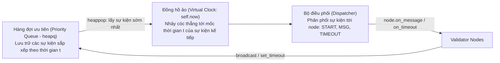

# Chuyên Đề 05: Mô Phỏng Mạng & 8 Kịch Bản Kiểm Thử Hệ Thống (T1 - T8)

Tài liệu này giải thích kiến trúc bộ mô phỏng mạng **Discrete Event Simulator (DES)** trong [sim.py](file:///e:/DISK_D/MDUY/Nam4/4.1%20Blockchain/Lab1/Workspace/src/sim.py), tính tất định của hệ thống trong [main.py](file:///e:/DISK_D/MDUY/Nam4/4.1%20Blockchain/Lab1/Workspace/src/main.py) và hướng dẫn phân tích toàn diện **8 kịch bản kiểm thử (T1 đến T8)** theo yêu cầu đề bài Lab 01.

---

## 1. Kiến Trúc Bộ Mô Phỏng Mạng Biến Cố Rời Rạc (DES)

Trong các bài toán mạng phân tán, nếu dùng luồng thực tế (`threading`, `socket`, `time.sleep()`):
- Tốc độ chạy rất chậm.
- Bị ảnh hưởng bởi CPU máy tính, hệ điều hành (không tất định).
- Không thể tái lập các tình huống lỗi mạng hiếm gặp (edge cases).

**Giải pháp**: Sử dụng **Discrete Event Simulation (DES)** trong [sim.py](file:///e:/DISK_D/MDUY/Nam4/4.1%20Blockchain/Lab1/Workspace/src/sim.py) với 3 thành phần cốt lõi:



### 1.1. Đồng Hồ Ảo (`Virtual Clock - self.now`)
- Thay vì chờ thời gian thực trôi qua, đồng hồ ảo nhảy cóc tức thì: từ $t = 0 \to t = 20 \to t = 220$...
- Giúp mô phỏng hàng nghìn thông điệp mạng phức tạp chỉ trong **chưa đầy 1 giây**!

### 1.2. Hàng Đợi Ưu Tiên (`heapq`)
- Mỗi sự kiện mạng được đẩy vào hàng đợi dưới dạng một tuple:
  $$(t, \text{seq}, \text{kind}, \text{src}, \text{dst}, \text{payload})$$
  - $t$: Thời điểm sự kiện sẽ diễn ra.
  - $\text{seq}$: Số thứ tự tuần tự để phá vỡ thế hòa (tie-breaking) nếu hai sự kiện có cùng $t$.
  - $\text{kind}$: Loại sự kiện (`START`, `MSG`, `TIMEOUT`, `SEND_READY`, `UNBLOCK`).
  - $\text{src}$: Node gửi; để `None` với event nội bộ như `START` hoặc `TIMEOUT`.
  - $\text{dst}$: Chỉ số của node đích nhận sự kiện.
  - $\text{payload}$: Dữ liệu thông điệp hoặc khóa timeout.

### 1.3. Trình Sinh Số Giả Ngẫu Nhiên Có Hạt Giống (`PRNG Seed`)
- Mọi quyết định ngẫu nhiên của mạng (drop, duplicate, delay và reorder) dùng chung `random.Random(seed)`.
  - Trước GST: message có thể bị drop; độ trễ lấy từ `0..pre_gst_max_delay`. Reorder được mô phỏng bằng cách cộng thêm độ trễ.
  - Từ GST trở đi: message không bị drop do mô hình mạng và độ trễ giữa hai peer không vượt quá `delta` (hoặc giới hạn riêng trong `link_delays`).
  - Duplicate có thể bật ở cả hai giai đoạn để kiểm tra xử lý message lặp.
- Với `seed = 42` cố định trong cấu hình, chuỗi các số ngẫu nhiên sinh ra trên máy Windows hay máy Linux đều **giống hệt nhau $100\%$**!

### 1.4. Cấu hình topology và chính sách mạng
Các thiết lập được đọc từ `Workspace/config/default.json`:

| Trường | Ý nghĩa |
| :--- | :--- |
| `links` | `"full"` hoặc danh sách link hai chiều dạng `[[0, 1], [1, 2]]`. |
| `link_delays` | Độ trễ tối đa riêng cho link, khóa dạng `"0-1"`; giá trị không vượt `delta`. |
| `gst`, `delta` | Mốc Global Stabilization Time và chặn trên độ trễ sau GST. |
| `pre_gst_max_delay` | Độ trễ tối đa dùng cho message gửi trước GST. |
| `pre_gst_drop_probability` | Xác suất drop trước GST, trong khoảng `[0, 1]`. |
| `duplicate_probability` | Xác suất tạo thêm một bản sao message. |
| `pre_gst_reorder_probability` | Xác suất cộng thêm trễ trước GST để tạo đảo thứ tự. |
| `rate_limit` | Giới hạn số message gửi trên mỗi kết nối trong một cửa sổ thời gian; `null` để tắt. |
| `peer_block` | Ngưỡng nhận message để tạm block peer quá mức và thời gian block; `null` để tắt. |

Thông điệp đồng thuận vẫn đi qua hàng đợi event. Proposal được truyền theo ba loại message: `HEADER`, `REQUEST_BODY` và `BODY`; node chỉ yêu cầu body sau khi nhận header, và proposer chỉ gửi body theo yêu cầu. Sự kiện mạng được ghi log với thời điểm, peer, loại message và height khi xác định được.

Ví dụ:
```json
{
  "links": [[0, 1], [1, 2]],
  "link_delays": {"0-1": 3, "1-2": 8},
  "delta": 20,
  "gst": 500,
  "pre_gst_max_delay": 100,
  "pre_gst_drop_probability": 0.05,
  "duplicate_probability": 0.02,
  "pre_gst_reorder_probability": 0.1,
  "rate_limit": {"max_messages": 50, "window": 100},
  "peer_block": {"max_messages": 100, "window": 100, "duration": 50}
}
```

Chạy simulator từ thư mục `Workspace`:
```bash
python -m src.main --config config/default.json --twice
python -m unittest discover -s tests -v
```

---

## 2. Tính Tất Định Tuyệt Đối & Log Hệ Thống (T8)

Đề bài yêu cầu: **Chạy lại cùng một cấu hình phải cho ra file log giống nhau từng byte và state hash cuối cùng phải bằng nhau.**

### 2.1. Định dạng chuẩn của bản ghi log
Mỗi biến cố trong mạng được ghi nhận theo định dạng có cấu trúc trong [sim.py: dòng 15](file:///e:/DISK_D/MDUY/Nam4/4.1%20Blockchain/Lab1/Workspace/src/sim.py#L15):
```
t={timestamp} node={tên_node} ev={sự_kiện} {các_tham_số_bổ_sung}
```
*Ví dụ mẫu trích từ log thật*:
```
t=0 node=V0 ev=ROUND_START height=1 round=0
t=0 node=V0 ev=PROPOSE height=1 round=0 txs=10
t=0 node=V0 ev=SEND type=PROPOSAL height=1
t=1 node=V0 ev=VOTE kind=PREVOTE height=1 round=0 block=507c3ea9
t=18 node=V0 ev=VOTE kind=PRECOMMIT height=1 round=0 block=507c3ea9
t=19 node=V0 ev=FINALIZE height=1 round=0 block=507c3ea9 state=d0f04c64
```

### 2.2. Kiểm tra tính tất định với cờ `--twice`
Trong [main.py: dòng 56-60](file:///e:/DISK_D/MDUY/Nam4/4.1%20Blockchain/Lab1/Workspace/src/main.py#L56-L60):
```python
if a.twice:
    net2 = run_sim(cfg)
    same = net.logs == net2.logs and net.nodes[0].state.hash() == net2.nodes[0].state.hash()
    print("Tất định (2 lần chạy giống hệt):", same)
    assert same
```

---

## 3. Phân Tích Toàn Diện 8 Kịch Bản Kiểm Thử (T1 -> T8)

Dưới đây là bảng tổng hợp và phân tích chuyên sâu 8 bài test theo yêu cầu của hội đồng môn học:

| Mã Test | Kịch bản mô phỏng (Scenario) | Mục tiêu kiểm chứng | Hành vi quan sát và Kết quả bắt buộc |
| :---: | :--- | :--- | :--- |
| **T1** | **Normal run, no faults** | Mạng bình thường, mọi validator trung thực | Tất cả các node hoàn thành chốt đủ 5 block (`heights = 5`), không có round nào bị timeout, cùng một chuỗi block và cùng một `state_hash` cuối cùng. |
| **T2** | **Duplicate/reordered messages** | Thông điệp bị nhân bản gửi lại nhiều lần và xáo trộn thứ tự đến | Nhờ **Quy tắc 7**, node nhận diện được phiếu bị trùng và bỏ qua (`slot = votes... if v.voter in slot: return`). Không bao giờ đếm 2 lần, không gây lỗi đồng thuận. |
| **T3** | **Invalid signature / wrong domain** | Kẻ xấu gửi giao dịch hoặc block có chữ ký giả mạo hoặc sai miền | Hàm `verify()` trả về `False`. Node ghi log `ev=REJECT reason=bad_header_sig` hoặc `bad_vote_sig` hoặc `bad_tx_sig` và bỏ qua thông điệp. |
| **T4** | **Replayed/duplicate transaction** | Một giao dịch hợp lệ của Alice bị gửi lại nhiều lần | Nhờ cơ chế kiểm tra `tx.nonce == state.nonces[sender] + 1`, giao dịch gửi lại sẽ bị từ chối với mã lỗi `bad_nonce` và chỉ được áp dụng đúng 1 lần duy nhất. |
| **T5** | **Drop/delay before synchrony** | Mất gói tin và độ trễ mạng cực lớn trước thời điểm $GST$ | Tính **Safety** được bảo toàn tuyệt đối: Không bao giờ có 2 block khác nhau được chốt ở cùng một height. Mạng có thể bị timeout tăng round nhưng không phân nhánh. |
| **T6** | **Proposer silent/crashed** | Proposer ở round 0 bị sập nguồn hoặc giữ im lặng | Đồng hồ đếm ngược `timeout_len(0)` kích hoạt `ev=TIMEOUT kind=PROPOSE`. Các node bỏ phiếu `PREVOTE NIL`, chuyển sang `PRECOMMIT NIL` rồi sang Round 1. Proposer mới được chọn và chuỗi tiếp tục tiến lên (Liveness). |
| **T7** | **Up to $f$ Byzantine equivocate** | Có tối đa $f$ ($f = 3$) validator gian lận hai mặt (gửi 2 phiếu khác nhau cho 2 nhóm) | Nhờ định lý giao điểm Quorum ($|Q_1 \cap Q_2| \ge f + 1$), luôn có ít nhất 1 node trung thực ở giao điểm ngăn chặn việc chốt 2 block. Node phát hiện và ghi log `ev=EQUIVOCATION`. |
| **T8** | **Same seed rerun twice** | Chạy mô phỏng lại 2 lần liên tiếp với cùng một file cấu hình | So sánh chuỗi log và hash trạng thái: Khớp $100\%$ từng ký tự (`Byte-identical logs and final state hash`). |

T2 và T5 có kiểm thử end-to-end trong `Workspace/tests/test_sim.py`:
- **T2** chạy mạng với duplicate và reorder, xác nhận mọi validator finalize cùng số block và không có hai hash khác nhau ở cùng height; đồng thời gửi lại một vote hợp lệ và một vote equivocation để xác nhận mỗi validator chỉ được đếm một lần.
- **T5** chạy nhiều seed với drop, delay và reorder trước GST; kiểm thử gom tất cả block đã finalize ở từng height và xác nhận không có hai hash khác nhau. T5 kiểm tra safety, không yêu cầu mọi node phải finalize đủ block trước khi mô phỏng dừng.

---

## 4. Kiểm Tra Tính An Toàn (Safety Check) Trong Code

Hàm [check_safety(nodes)](file:///e:/DISK_D/MDUY/Nam4/4.1%20Blockchain/Lab1/Workspace/src/main.py#L36-L40) được kích hoạt ngay sau khi kết thúc mô phỏng để bảo đảm không có bất kỳ fork nào:

```python
def check_safety(nodes):
    nodes = [x for x in nodes if not x.is_byzantine]
    if not nodes:
        raise ValueError("không có honest node")
    m = max(len(x.ledger) for x in nodes)
    for h in range(m):
        # Tập hợp tất cả các mã hash của block tại height h của mọi node
        hashes = {x.ledger[h].hash() for x in nodes if len(x.ledger) > h}
        if len(hashes) > 1:
            raise AssertionError(f"FORK ở height {h+1}!")
    return m
```
- Checker xét mọi height đã được bất kỳ honest nào chốt; node có ledger rỗng không che được fork.
- Safety riêng không chứng minh tiến triển. CLI gọi thêm check_completion để kiểm mọi honest
  chốt đủ mục tiêu và cùng state; hết t_end mà chưa xong trả lỗi INCOMPLETE.

---

## 5. Hướng Dẫn Thực Hành & Khai Thác Hệ Thống

Mở terminal trong thư mục `Workspace` và thực hiện các thao tác sau:

### 5.1. Chạy kịch bản cơ bản
```powershell
python -m src.main --config config/default.json
```
**Kết quả in ra màn hình mẫu**:
```text
OK: 5 block được chốt, mọi node cùng chuỗi.
state hash cuối: 0b837be96db72e1f
state: {'Alice/msg': 'v5', 'Bob/msg': 'v5', 'Carol/msg': 'v5'}
```

### 5.2. Chạy kiểm tra tính tất định (T8)
```powershell
python -m src.main --twice
```
**Kết quả in ra**:
```text
OK: 5 block được chốt, mọi node cùng chuỗi.
state hash cuối: 0b837be96db72e1f
state: {'Alice/msg': 'v5', 'Bob/msg': 'v5', 'Carol/msg': 'v5'}
Tất định (2 lần chạy giống hệt): True
```

### 5.3. Xem và phân tích file nhật ký (`logs/run.log`)
File log được lưu tự động tại `logs/run.log`. Bạn có thể lọc nhanh các sự kiện quan trọng bằng PowerShell:
- **Xem các sự kiện chốt block (FINALIZE)**:
  ```powershell
  Get-Content logs/run.log | Select-String "ev=FINALIZE"
  ```
- **Xem các sự kiện đề xuất block (PROPOSE)**:
  ```powershell
  Get-Content logs/run.log | Select-String "ev=PROPOSE"
  ```
- **Xem các sự kiện bỏ phiếu (VOTE)**:
  ```powershell
  Get-Content logs/run.log | Select-String "ev=VOTE" | Select-Object -First 10
  ```
