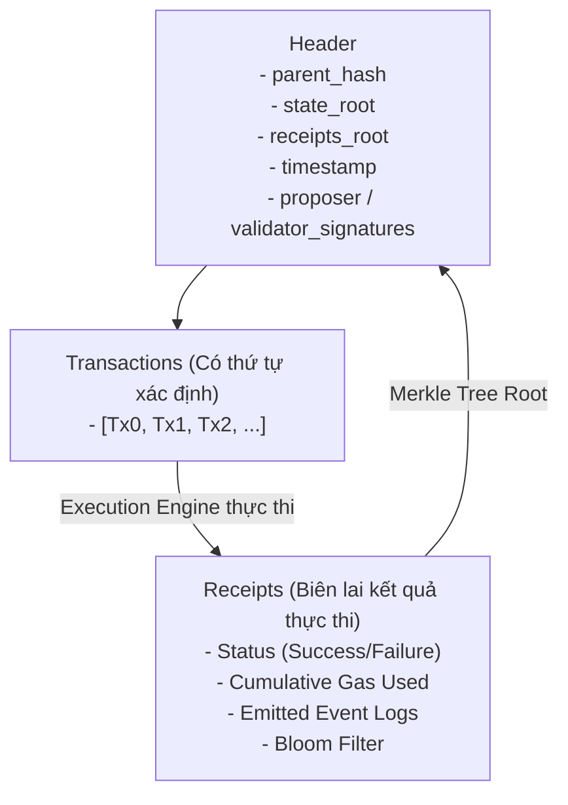
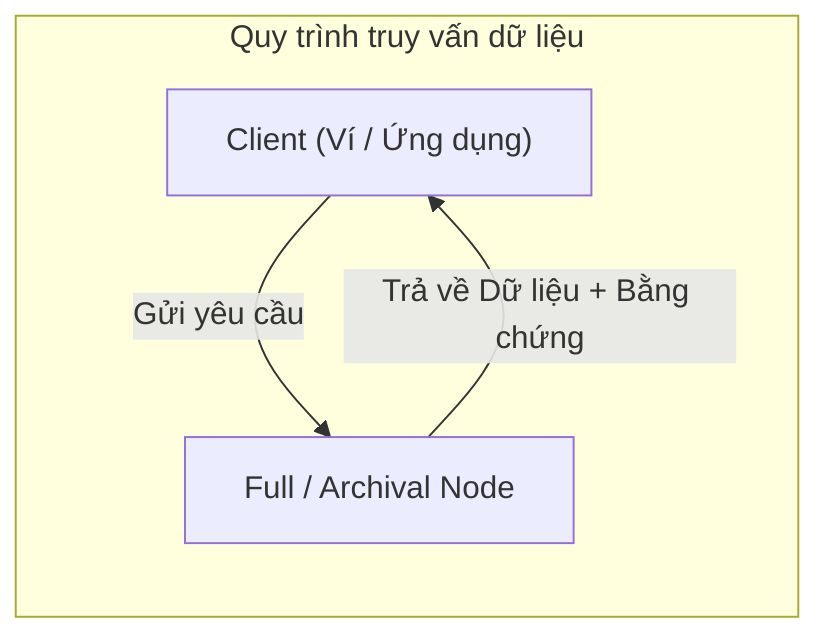
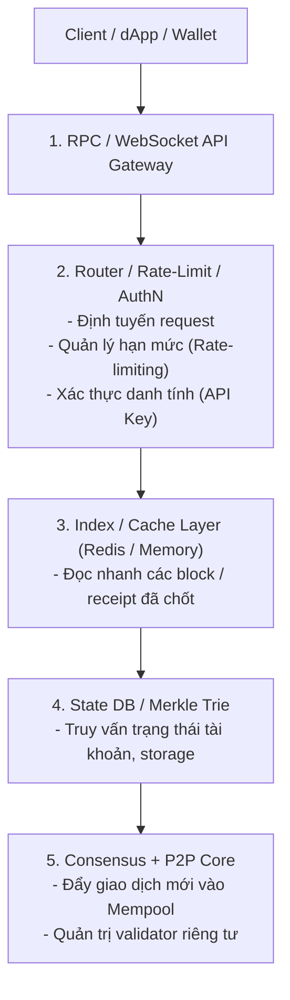
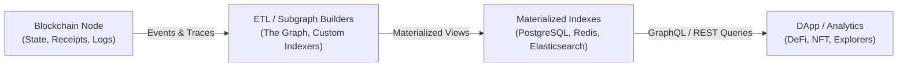
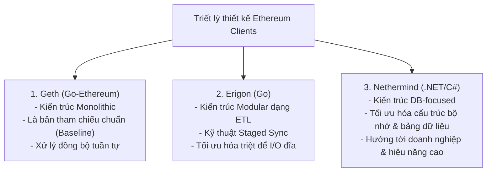
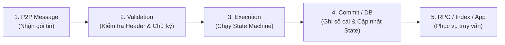

# Chuyên Đề 06: RPC Stack, Indexing Pipeline & Nghiên Cứu Kiến Trúc Client

Tài liệu này hệ thống hóa toàn bộ các kiến thức nâng cao về **Kiến trúc phục vụ ứng dụng, Pipeline xử lý dữ liệu và Các triết lý thiết kế Node Client** được giảng dạy trong bài giảng lý thuyết [Lab01-presentation.pdf](file:///e:/DISK_D/MDUY/Nam4/4.1%20Blockchain/Lab1/Document/Lab01-presentation.pdf) (Slide trang 9, 11, 15 - 21).

---

## 1. Cấu Trúc Khối Mở Rộng & Biên Lai Giao Dịch (Block Structure & Receipts)

Trong mô hình tối giản của Lab 01 ([common.py](file:///e:/DISK_D/MDUY/Nam4/4.1%20Blockchain/Lab1/Workspace/src/common.py)), cấu trúc Block chỉ gồm Header và danh sách Transactions. Tuy nhiên, trong các mạng blockchain sản xuất thực tế (như Ethereum hay Cosmos - xem Slide trang 9), cấu trúc khối hoàn chỉnh được thiết kế như sau:

### 1.1. Biên lai giao dịch (Transaction Receipt) là gì?
Khi máy ảo/bộ thực thi (Execution Engine) chạy một giao dịch, nó không chỉ cập nhật trạng thái (`State`) mà còn tạo ra một **Receipt** ghi nhận bằng chứng về kết quả của giao dịch đó:
- **Trạng thái thực thi (`status`)**: Thành công (`1`) hoặc Thất bại (`0` - ví dụ do revert, hết gas, lỗi assertion).
- **Lượng tài nguyên tiêu thụ (`cumulative_gas_used`)**: Tổng số gas đã dùng tính đến thời điểm giao dịch này kết thúc trong khối.
- **Nhật ký biến cố (`event logs`)**: Dữ liệu do hợp đồng thông minh phát ra (`emit Event(...)`), ví dụ sự kiện chuyển tiền `Transfer(from, to, amount)`.
- **Bộ lọc Bloom (`logs_bloom`)**: Cấu trúc dữ liệu xác suất 256-byte giúp client lọc nhanh xem một khối có chứa sự kiện nào đó hay không mà không cần đọc từng biên lai.

### 1.2. Tại sao ứng dụng đọc Receipts thay vì đọc chênh lệch trạng thái (State Diffs)?
> [!IMPORTANT]
> **Nguyên lý cốt lõi (Slide trang 9)**: *"Execution produces receipts and the new state root. Applications read receipts, not raw diffs."*

1. **Phân tách trách nhiệm (Decoupling)**: 
   - State là kho lưu trữ hiện tại (Key-Value), rất khó để biết *chuyện gì đã xảy ra trong quá khứ* nếu chỉ nhìn vào trạng thái hiện tại (ví dụ: số dư của Bob hiện là $100, nhưng trước đó ai chuyển cho Bob bao nhiêu tiền thì State không lưu trữ trực tiếp).
   - Receipts lưu trữ chính xác các **biến cố nghiệp vụ** phát sinh tại thời điểm thực thi.
2. **Hiệu năng truy vấn**:
   - Để kiểm tra xem thanh toán của người dùng đã hoàn tất chưa, ứng dụng Web3/ví dApp chỉ cần gọi RPC lấy receipt của giao dịch đó (`eth_getTransactionReceipt`).
   - Việc đọc State diff đòi hỏi phải so sánh cây trạng thái trước và sau khối, tiêu tốn rất nhiều tài nguyên CPU và I/O đĩa.

---

## 2. So Sánh Chuyên Sâu: Light Client vs Stateless Client

Cả hai mô hình này đều hướng tới mục tiêu: **Giúp thiết bị yếu (điện thoại, trình duyệt) xác thực tính đúng đắn của dữ liệu blockchain mà không cần lưu trữ toàn bộ trạng thái hàng trăm Gigabyte** (Slide trang 11).

| Tiêu chí | Light Client (Xác thực nhẹ) | Stateless Client (Không trạng thái) |
| :--- | :--- | :--- |
| **Dữ liệu lưu trữ cục bộ** | Lưu toàn bộ **Block Headers** (rất nhẹ, vài chục MB). | **Hoàn toàn không lưu trữ State** và không cần lưu chuỗi header đầy đủ. |
| **Cơ chế xác thực** | Tự kiểm tra chữ ký đồng thuận trên Header; khi cần đọc dữ liệu thì yêu cầu **Merkle Proof**. | Xác thực trực tiếp từng khối/giao dịch thông qua **Witness (nhân chứng)** đi kèm. |
| **Khái niệm Witness** | Nhận Merkle path cho từng giá trị được hỏi (`key`). | Nhận một tập hợp chứa tất cả giá trị tiền điều kiện và bằng chứng Merkle/Verkle cần thiết để thực thi block. |
| **Nút thắt chi phí (Bottleneck)** | Phụ thuộc vào Full node để xin bằng chứng theo nhu cầu. | **Kích thước bằng chứng và băng thông mạng (Proof size & Bandwidth)** chiếm ưu thế chi phí. |
| **Ứng dụng thực tế** | Ví tiền mã hóa trên thiết bị di động (Metamask mobile), Cầu nối xuyên chuỗi (Light client bridge). | Lộ trình mở rộng quy mô Ethereum (Statelessness với Verkle Trees / EIP-4444). |

### Sơ đồ luồng hoạt động:
- **Light Client**: `Headers (đã lưu) + Merkle Proof (tải về) => Xác minh tính hợp lệ của câu trả lời`.
- **Stateless Client**: `Khối mới + Witness (toàn bộ dữ liệu liên quan) => Tự chạy lại giao dịch để đối chiếu State Root`.

---

## 3. Kiến Trúc Tầng RPC Cho Ứng Dụng (RPC Stack)

Tầng RPC là cánh cổng duy nhất để thế giới bên ngoài (người dùng, sàn giao dịch, dApp, bot) giao tiếp với mạng Blockchain (Slide trang 15).

### 3.1. Phân Tách Kênh Công Khai & Kênh Nhạy Cảm (Public vs Private Endpoints)
Trong thiết kế hạ tầng blockchain chuẩn doanh nghiệp, tuyệt đối **không bao giờ mở trực tiếp cổng của node validator ra Internet**:
1. **Public Read Channel (Kênh đọc công khai)**:
   - Các API truy vấn dữ liệu: `eth_blockNumber`, `eth_getBalance`, `eth_getLogs`, `eth_call`.
   - Có thể nhân bản vô hạn bằng các cụm máy chủ Proxy/Load Balancer đứng trước các Read-Only Node.
2. **Sensitive / Private Channel (Kênh ghi và quản trị nhạy cảm)**:
   - Kênh nhận giao dịch (`eth_sendRawTransaction`) cần được kiểm soát dung lượng để tránh tràn Mempool.
   - Các API quản trị nội bộ (`admin_*`, `personal_*`, ký phiếu bầu validator): **Chỉ mở nội bộ trong mạng LAN (VPC)**, chặn hoàn toàn truy cập từ bên ngoài qua Firewall.

---

## 4. Pipeline Lập Chỉ Mục & Bộ Đệm (Indexing & Caching Pipeline)

Một hạn chế cố hữu của Blockchain là: **Dữ liệu được lưu trữ dưới dạng sổ cái nối tiếp (Append-only Log) và Key-Value Store**.

### 4.1. Tại sao cần Pipeline Indexing?
> [!NOTE]
> **Khái niệm then chốt (Slide trang 16)**: *"Indexing converts append-only logs into query-friendly tables."*

- **Ví dụ thực tế**: Người dùng muốn xem *"Toàn bộ lịch sử giao dịch mua token XYZ của ví Alice trong tháng 10/2026"*.
- Nếu hỏi trực tiếp Node Blockchain: Node sẽ phải quét từ khối đầu tiên đến khối mới nhất, đọc từng receipt, bóc tách từng event $\to$ Mất hàng chục phút và làm nghẽn toàn bộ node!
- **Giải pháp**:
  1. Bộ trích xuất (ETL / Subgraph Builder) liên tục lắng nghe các sự kiện và biên lai từ node.
  2. Phân tích cú pháp và ghi vào cơ sở dữ liệu quan hệ (PostgreSQL) hoặc cơ sở dữ liệu tìm kiếm (Elasticsearch).
  3. Ứng dụng dApp truy vấn vào cơ sở dữ liệu đã lập chỉ mục (Materialized Index) với thời gian phản hồi chỉ tính bằng mili-giây.

---

## 5. An Ninh Tại Tầng Biên API (Security Exposure at API Edge)

Cổng kết nối API công khai là bề mặt chịu nhiều cuộc tấn công nhất của một hệ thống Blockchain (Slide trang 17).

### 5.1. Các Nguy Cơ Bị Tấn Công
1. **Flooding / DDoS Attack**: Kẻ tấn công gửi hàng triệu yêu cầu RPC trong thời gian ngắn làm cạn kiệt tài nguyên mạng và CPU của node.
2. **Replay Attack**: Gửi lại các yêu cầu hoặc giao dịch đã cũ nhằm gây nghẽn hàng đợi hoặc trục lợi.
3. **Expensive Queries (Truy vấn độc hại tiêu tốn tài nguyên)**:
   - Gọi `eth_getLogs` với dải khối từ block `0` đến `latest` mà không lọc địa chỉ hợp đồng.
   - Gọi `eth_call` với dữ liệu đầu vào kích hoạt vòng lặp tính toán vô tận trong EVM.

### 5.2. Biện Pháp Phòng Vệ Chuẩn Hóa (Mitigations)
- **Hạn mức & Giới hạn tần suất (Quotas & Rate-limiting)**: Dùng thuật toán Token Bucket hoặc Leaky Bucket giới hạn mỗi IP/API Key chỉ được gửi tối đa $X$ request/giây.
- **Xác thực API Keys**: Yêu cầu người dùng đăng ký tài khoản (giống mô hình của Alchemy, Infura, QuickNode).
- **Bộ đệm thông minh (Caching)**: Dữ liệu của các khối đã chốt (`finalized blocks`) là bất biến, do đó kết quả truy vấn có thể lưu trữ vĩnh viễn trên Redis hoặc CDN mà không cần chạm vào node.
- **Nắn chỉnh truy vấn (Query Shaping)**:
  - Bắt buộc giới hạn phạm vi khối tối đa cho mỗi lần gọi `getLogs` (ví dụ: không quá 2,000 blocks/lần).
  - Áp đặt thời gian chờ tối đa (Timeout) cho mỗi truy vấn (ví dụ: 5 giây).

> [!TIP]
> **Nguyên tắc thiết kế vàng (Slide trang 17)**: *"Minimize stateful side-effects at public endpoints."* Tầng API công khai cần được giữ ở trạng thái không phụ thuộc trạng thái (stateless) nhiều nhất có thể.

---

## 6. Nghiên Cứu Thực Tế: Triết Lý Thiết Kế Các Ethereum Clients

Trong hệ sinh thái Ethereum, tính đa dạng của phần mềm máy trạm (Client Diversity) giúp mạng tránh được lỗi sụp đổ diện rộng nếu một loại client gặp bug. Bài giảng lý thuyết (Slide trang 18) so sánh 3 đại diện tiêu biểu:

### Bài học rút ra:
> *"Different philosophies reflect different bottlenecks: CPU, I/O, database layout."*
- **Geth**: Ưu tiên sự ổn định, an toàn và dễ bảo trì vì là client nền tảng đầu tiên.
- **Erigon**: Nhận ra nút thắt lớn nhất của Full node là **I/O đọc/ghi ổ đĩa** khi cập nhật cây Merkle. Erigon tái cấu trúc toàn bộ việc đồng bộ thành các giai đoạn tách biệt (Staged Sync: tải header $\to$ tải body $\to$ phục hồi người gửi $\to$ thực thi $\to$ băm trạng thái một lần duy nhất), giúp giảm mạnh số lần truy xuất ngẫu nhiên trên ổ SSD.
- **Nethermind**: Tập trung vào việc tối ưu hóa cách biểu diễn dữ liệu trong bộ nhớ RAM và kiến trúc lưu trữ bảng dữ liệu để đạt throughput tối đa.

---

## 7. Khung Đánh Đổi Thiết Kế Hệ Thống (Design Trade-offs)

Khi thiết kế một hệ thống Blockchain hoặc triển khai một cụm node trong thực tế, kiến trúc sư hệ thống phải đối mặt với các lựa chọn đánh đổi đánh giá theo bảng sau (Slide trang 19):

| Khía cạnh kiến trúc | Lựa chọn A (Option A) | Lựa chọn B (Option B) | Đánh giá sự đánh đổi (Trade-off Analysis) |
| :--- | :--- | :--- | :--- |
| **Lưu trữ trạng thái** *(State retention)* | **Archival Node** (Lưu toàn bộ lịch sử) | **Pruned Node** (Chỉ lưu trạng thái gần nhất) | Option A tốn hàng Terabyte ổ đĩa nhưng cho phép tra cứu trạng thái ở bất kỳ khối nào trong quá khứ; Option B tiết kiệm chi phí phần cứng. |
| **Chế độ đồng bộ** *(Sync mode)* | **Full Replay** (Chạy lại từ khối số 1) | **Snap / Checkpoint Sync** (Dùng bản chụp / neo tin cậy) | Option A tự xác thực toàn diện không cần tin ai nhưng mất nhiều ngày để vào mạng; Option B khởi động vào mạng chỉ trong vài phút. |
| **Cơ chế xác thực** *(Verification)* | **Self-verify** (Tự tính toán lại toàn bộ) | **Trusted Anchors** (Tin vào hash neo ban đầu) | Option A đạt mức độ phi tập trung và bảo mật toán học cao nhất; Option B đánh đổi một phần niềm tin vào điểm neo để đổi lấy tốc độ. |
| **Phương thức phục vụ** *(Serving)* | **Peer-to-peer (P2P)** (Trao đổi trực tiếp trong mạng) | **API Gateway** (Qua cổng proxy tập trung) | P2P phân tán, chống kiểm duyệt nhưng độ trễ cao; API Gateway độ trễ thấp, dễ tích hợp dApp nhưng có điểm tập trung rủi ro. |
| **Vai trò của Node** *(Role)* | **Validator Node** (Tham gia biểu quyết đồng thuận) | **Observer Node** (Chỉ quan sát và phục vụ API) | Validator đòi hỏi độ sẵn sàng cao, bảo vệ private key nghiêm ngặt; Observer chỉ phục vụ đọc dữ liệu và mở rộng quy mô dApp. |

---

## 8. Luồng Dữ Liệu Hoàn Chỉnh & Quản Trị Độ Trễ (End-to-End Dataflow)

Toàn bộ vòng đời của một thông điệp trong kiến trúc Blockchain Node trải qua pipeline 5 chặng liên hoàn (Slide trang 20):

### Đo Lường Hiệu Năng & Ngân Sách Độ Trễ (Latency & Error Budgets)
> [!IMPORTANT]
> **Tuyên ngôn kiến trúc (Slide trang 20)**: *"Each box is measurable: latency and error budgets belong here."*

Một kỹ sư blockchain chuyên nghiệp cần đặt ra các chỉ số chất lượng dịch vụ (Service Level Objectives - SLO) cụ thể cho từng hộp trong pipeline:
1. **P2P Message Ingestion**: Đo lường thời gian giải mã gói tin (framing), khử trùng lặp (`dedup`), độ trễ phát tán thông điệp (Gossip latency).
2. **Header/Block Validation**: Ngân sách thời gian xác minh chữ ký Ed25519/Secp256k1 và kiểm tra liên kết cha (`parent hash`).
3. **Execution / State Transition**: Thời gian thực thi danh sách giao dịch; cần có cơ chế ngắt (gas limit / CPU timeout) để không làm trễ bước đồng thuận tiếp theo.
4. **Commit & Persistence**: Tốc độ ghi dữ liệu xuống đĩa (Disk I/O write) và tính toán băm trạng thái (`state_root`).
5. **RPC Serving**: Độ trễ phản hồi truy vấn HTTP/WebSocket tới khách hàng (ví dụ: $99\%$ request phải được phục hồi trong $< 100\text{ ms}$).

---

## 9. Tổng Kết 3 Thông Điệp Then Chốt (Takeaways - Slide 21)

1. **Kiến trúc Node biến các quy tắc giao thức lý thuyết thành phần mềm vận hành thực tế**: Đồng thuận không chỉ là thuật toán trên giấy mà là sự phối hợp nhịp nhàng giữa mạng P2P, bộ nhớ lưu trữ, máy trạng thái và API.
2. **Các chế độ đồng bộ (Sync modes) là sự đánh đổi trực tiếp giữa khối lượng công việc xác minh và tốc độ khởi động**: Khởi động càng nhanh thì càng phải dựa vào các điểm neo tin cậy hoặc bản chụp trạng thái.
3. **Sự phân tách trách nhiệm rõ ràng (Separation of concerns) là chìa khóa nâng cao tính bảo mật và độ tin cậy**: Tách biệt luồng đọc công khai và luồng ghi nhạy cảm; tách biệt sổ cái giao dịch với tầng lập chỉ mục truy vấn ứng dụng.
