# Sequence diagram kiểm thử T1–T8

Tài liệu mô tả luồng thực thi của **20 test method**, chia thành **14 sequence diagram**. Nguồn đối chiếu là mã hiện tại trong `Workspace/tests/e2e/`, `Workspace/src/`, `tests/c_helpers.py` và `tests/independent_oracle.py`.

## Phạm vi và cách đọc

- Đây là sơ đồ từ mã nguồn, **không phải trace của một lần chạy test đã được ghi nhận**. Tài liệu không công bố kết quả PASS/FAIL thực tế.
- Mũi tên liền biểu diễn lời gọi hoặc gửi yêu cầu; nét đứt biểu diễn trả kết quả hoặc giao thông điệp đã được lên lịch. Nhãn chỉ rõ handler và loại thông điệp.
- `Net` là bộ mô phỏng sự kiện rời rạc. Mọi validator chạy bằng callback trong cùng vòng lặp mô phỏng; các lifeline không có nghĩa mỗi node là một thread.
- Một lifeline nhóm honest có thể đại diện nhiều node. Mỗi node xác minh và đếm quorum cục bộ. Một broadcast được rút gọn thành một mũi tên.
- Trừ nhánh T3 cố tình inject `PROPOSAL` lỗi, việc phát tán block bình thường dùng **HEADER → REQUEST_BODY → BODY**, không gửi nguyên proposal ngay từ đầu.
- Các sơ đồ rút gọn xen kẽ sự kiện; `loop`, `alt`, `opt` mô tả nhánh và điều kiện của code. Không gán một thứ tự mạng cụ thể, block thắng hoặc round commit khi test không assert điều đó.
- Các nhánh phục hồi ở T5–T7 là khả năng của engine, không phải khẳng định mọi nhánh đều xuất hiện trong từng lần chạy.
- `run_with_byzantine` chuyển behaviors thành config JSON và gọi `run_sim` với production factory. Helper này không thay thế Node của runner.
- `assert_honest_certificates` kiểm certificate và, với mô hình chuẩn, gọi oracle độc lập để kiểm lại ledger/state. Nó không tự yêu cầu hoàn tất đủ height nếu không truyền ràng buộc completion tương ứng.

## Điều kiện nền

Các trường không bị test ghi đè được lấy từ [default.json](../Workspace/config/default.json): n=10, f=3, Q=7, heights=5, seed=42, GST=1000, delta=20, duplicate=0.05, reorder=0.1, rate limit 50 thông điệp/100 đơn vị thời gian, peer block 100 thông điệp/100 và duration=50, base_timeout=200, timeout_inc=100, t_end=100000. Ba account Alice/Bob/Carol có 5 giao dịch mỗi account, tối đa 10 giao dịch/block.

Đây là **điều kiện test**, không phải cấu hình sản xuất. `Q = 2f + 1`; runner chuẩn yêu cầu `n = 3f + 1`. Identity fixture cố định độc lập seed mạng.

## Chỉ mục và mức kiểm tra

| Nhóm | Sơ đồ | Phạm vi assertion cần lưu ý |
|---|---|---|
| T1 | T1 | Không lỗi, đủ 5 height, round 0, data/nonce/hash chuẩn |
| T2 | T2a, T2b, T2c | T2a/T2c không bắt buộc completion; T2b gọi handler trực tiếp |
| T3 | T3 | Sáu thông điệp lỗi/node ở t=1; các mã từ chối chính xác và progress(5) |
| T4 | T4 | Admission thật qua mạng, gossip, replay trước/sau commit, thực thi đúng một lần |
| T5 | T5 | Safety/certificates của khối đã chốt, không assert progress đủ height |
| T6 | T6 | Một hoặc ba Silent, honest phải tiến đủ 5 height |
| T7 | T7a, T7b, T7c | Safety/progress(5)/certificates; log tấn công được assert tùy method |
| T8 | T8a, T8b, T8c | Hai lần hoàn tất đúng và giống nhau; đối chứng incomplete/V9 bị hỏng |

Mỗi sơ đồ có ba định dạng trong [sequence-diagrams/](sequence-diagrams/README.md): `.mmd` để chỉnh sửa, `.svg` để phóng to hoặc đưa vào báo cáo, `.png` để chèn ảnh. Cả 14 sơ đồ đã được kiểm cú pháp và render thành SVG/PNG.

## T1 — Mạng bình thường

Nguồn: [test_t1_normal.py](../Workspace/tests/e2e/test_t1_normal.py).

**Test method:**

- `test_t1_normal_execution`

**Thiết lập:** seed=42, GST=0, delta=1; không Byzantine/drop/duplicate/reorder; rate_limit=None, peer_block=None; 10 node, 5 height.

**Điểm cần đọc đúng:** Luồng HEADER → REQUEST_BODY → BODY được vẽ rõ. Nhóm H đại diện các node nhận; quorum được đếm riêng tại từng node, không có bộ đếm tập trung.

[Mermaid](sequence-diagrams/t1-normal.mmd) · [SVG](sequence-diagrams/t1-normal.svg) · [PNG](sequence-diagrams/t1-normal.png)

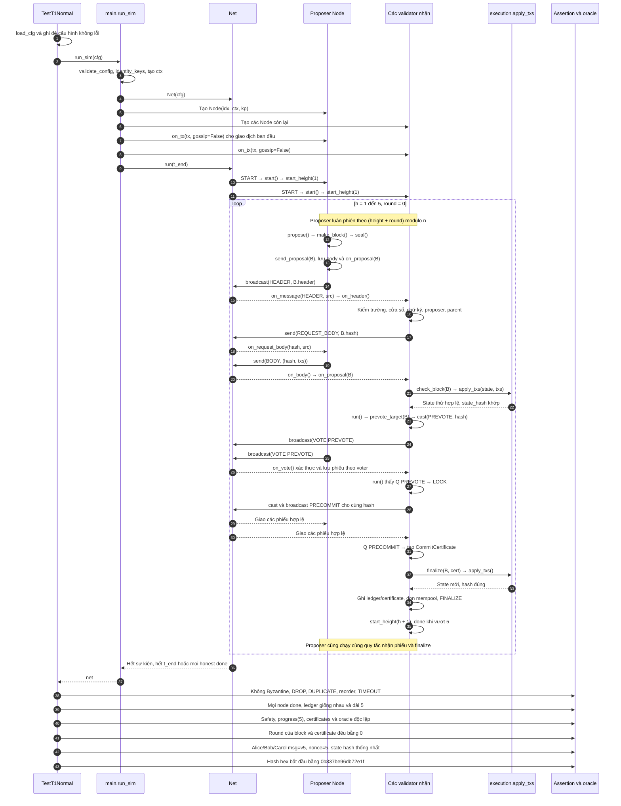

## T2a — Nhân bản và đảo thứ tự trên mạng

Nguồn: [test_t2_duplicate_reorder.py](../Workspace/tests/e2e/test_t2_duplicate_reorder.py).

**Test method:**

- `test_t2_network_duplicate_and_reorder_safety`

**Thiết lập:** seed=42, GST=5000, pre_gst_max_delay=50, drop=0, duplicate=0.25, reorder=0.35.

**Điểm cần đọc đúng:** Test này xác nhận lỗi mạng xảy ra, safety, certificate và ledger bằng nhau. Không có assertion bắt buộc đủ 5 height hoặc tất cả done.

[Mermaid](sequence-diagrams/t2a-duplicate-reorder.mmd) · [SVG](sequence-diagrams/t2a-duplicate-reorder.svg) · [PNG](sequence-diagrams/t2a-duplicate-reorder.png)

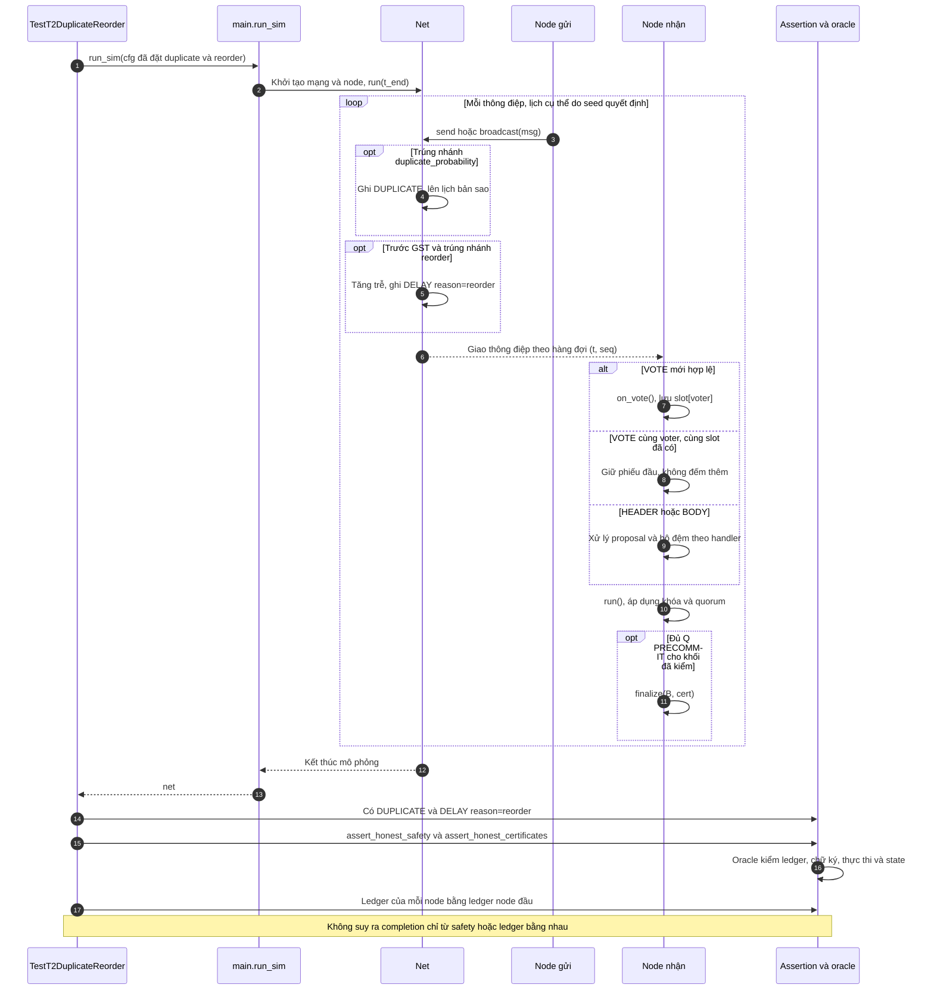

## T2b — Kiểm tra trực tiếp chống đếm phiếu trùng

Nguồn: [test_t2_duplicate_reorder.py](../Workspace/tests/e2e/test_t2_duplicate_reorder.py).

**Test method:**

- `test_t2_rule7_anti_double_voting_and_equivocation`

**Thiết lập:** make_nodes() tạo Node thật trên RecordingNet; receiver=V0, voter=V1, slot=(1,0,PREVOTE).

**Điểm cần đọc đúng:** Đây là kiểm thử handler trực tiếp nằm trong file E2E: không gọi run_sim và không có vòng lặp Net.run. Phiếu A/B có chữ ký hợp lệ của cùng V1.

[Mermaid](sequence-diagrams/t2b-rule7.mmd) · [SVG](sequence-diagrams/t2b-rule7.svg) · [PNG](sequence-diagrams/t2b-rule7.png)

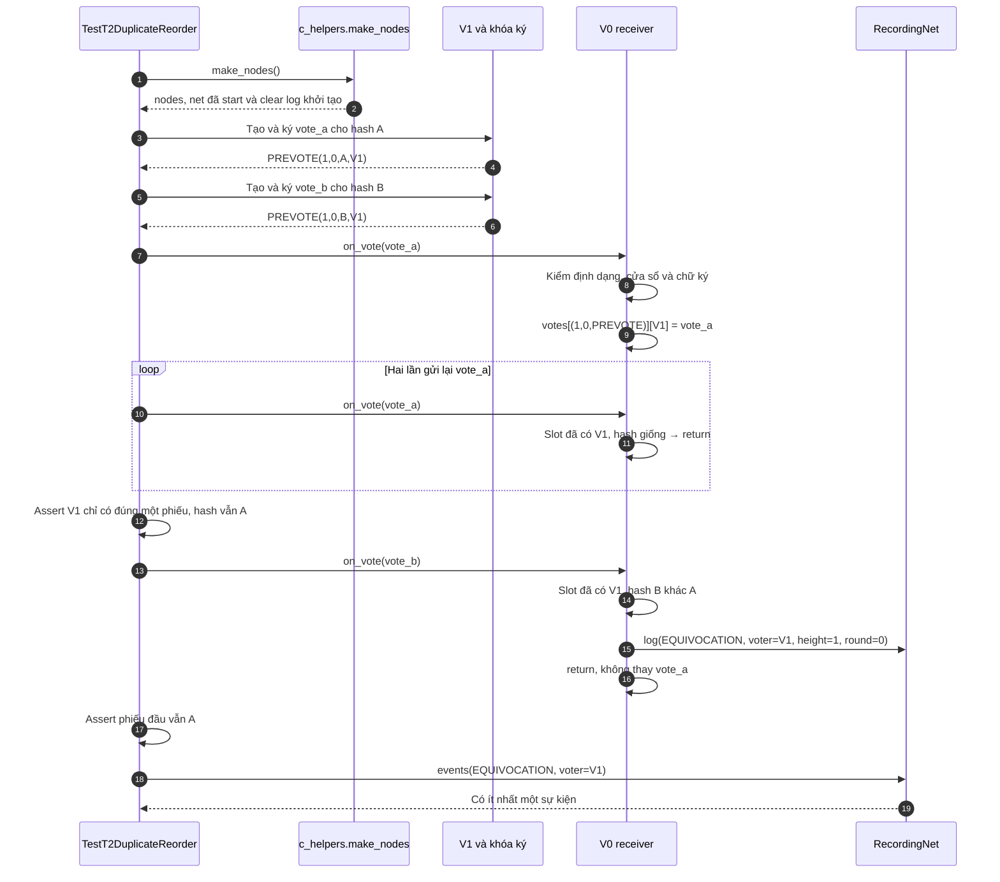

## T2c — Byzantine phát lại thông điệp

Nguồn: [test_t2_duplicate_reorder.py](../Workspace/tests/e2e/test_t2_duplicate_reorder.py).

**Test method:**

- `test_t2_byzantine_replay_attack_node`

**Thiết lập:** V2=Replay(delay=20, limit=10), seed=42; các tham số khác kế thừa default.json.

**Điểm cần đọc đúng:** Replay phát lại nguyên thông điệp, không ký lại bằng danh tính người gửi gốc. Test yêu cầu BYZ_REPLAY, safety và certificate trên honest; không gọi assert_honest_progress.

[Mermaid](sequence-diagrams/t2c-replay-node.mmd) · [SVG](sequence-diagrams/t2c-replay-node.svg) · [PNG](sequence-diagrams/t2c-replay-node.png)

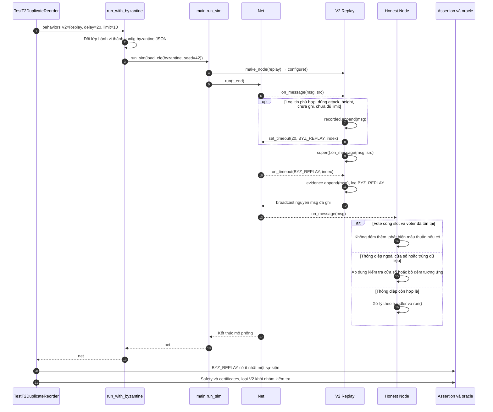

## T3 — Chèn chữ ký và chứng nhận sai

Nguồn: [test_t3_invalid_signatures.py](../Workspace/tests/e2e/test_t3_invalid_signatures.py).

**Test method:**

- `test_rejected_and_logged_and_chain_continues`

**Thiết lập:** mock.patch src.main.Net=InjectNet; dùng cấu hình nền; chèn 6 thông điệp lỗi tới mỗi node ở t=1.

**Điểm cần đọc đúng:** V3 được dùng làm nguồn chèn lỗi và bị loại khỏi tập assertion cuối. Trong test này run_sim không cấu hình V3 thành lớp Byzantine: các node vẫn được tạo theo cấu hình nền. Lỗi được đưa thẳng vào hàng đợi MSG, không phải gửi qua Net.send.

[Mermaid](sequence-diagrams/t3-invalid-signatures.mmd) · [SVG](sequence-diagrams/t3-invalid-signatures.svg) · [PNG](sequence-diagrams/t3-invalid-signatures.png)

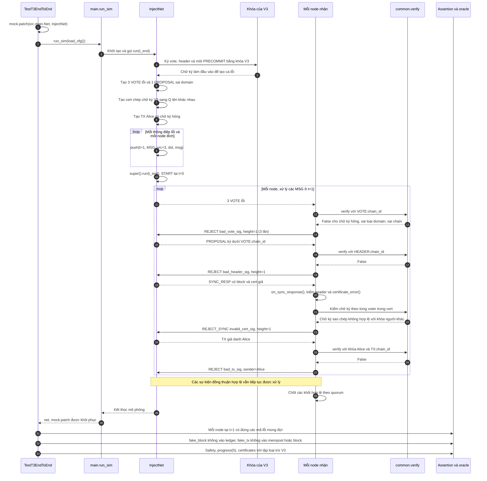

## T4 — Nhận lần đầu và phát lại giao dịch

Nguồn: [test_t4_replay_tx.py](../Workspace/tests/e2e/test_t4_replay_tx.py).

**Test method:**

- `test_t4_transaction_replay_prevention`

**Thiết lập:** GST=0, delta=1, heights=3, txs_per_account=0, max_txs_per_block=1, t_end=2000; tắt duplicate và throttling.

**Điểm cần đọc đúng:** Giao dịch đi vào qua Net.send, không nạp sẵn mempool. Replay bị chặn tại seen_tx_hashes nên test không yêu cầu log bad_nonce. Không cố định giao dịch phải nằm ở block nào.

[Mermaid](sequence-diagrams/t4-transaction-replay.mmd) · [SVG](sequence-diagrams/t4-transaction-replay.svg) · [PNG](sequence-diagrams/t4-transaction-replay.png)

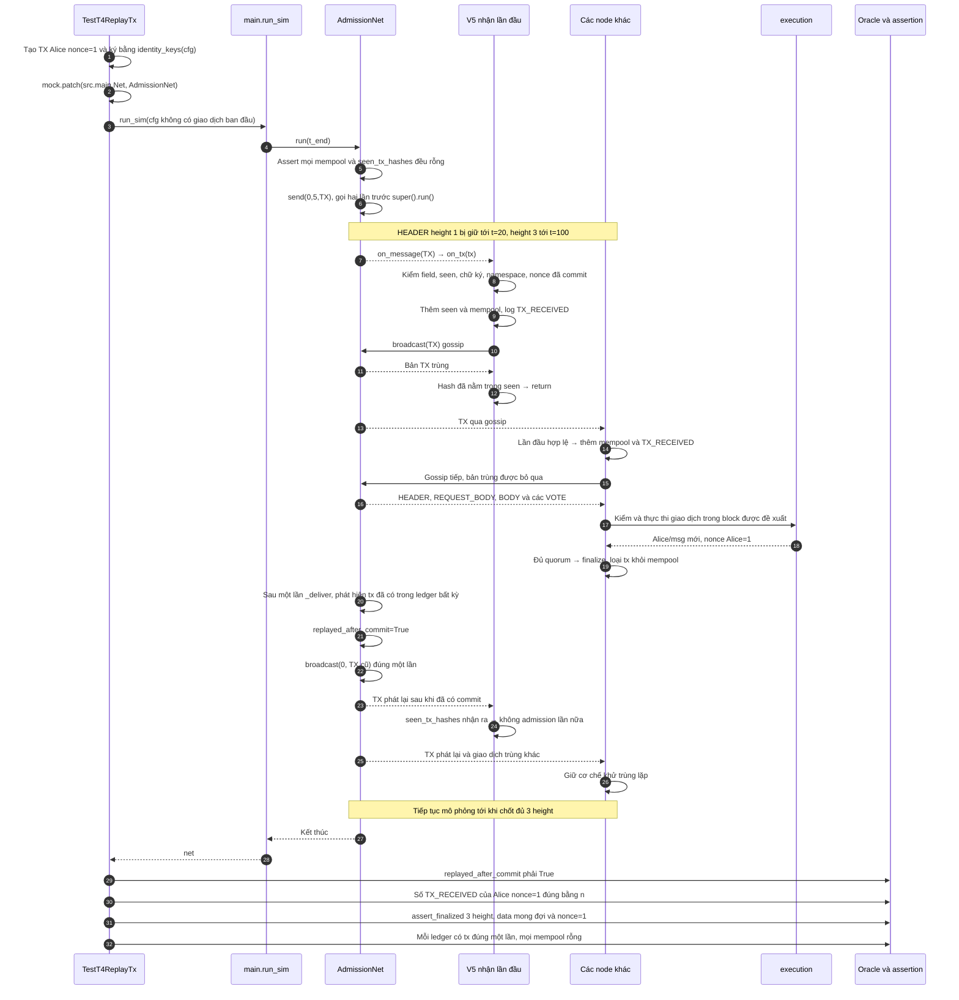

## T5 — Mất và trễ tin trước GST

Nguồn: [test_t5_gst_safety.py](../Workspace/tests/e2e/test_t5_gst_safety.py).

**Test method:**

- `test_t5_pre_gst_drops_and_delays_preserve_safety`
- `test_t5_extreme_pre_gst_partition_safety`

**Thiết lập:** Ca thường: seed=42/43/44/99, GST=1500, max_delay=200, drop=0.15, reorder=0.2, delta=20, heights=5. Ca cực đoan: seed=7, GST=2000, max_delay=300, drop=0.40, reorder=0.30, delta=20, heights=3.

**Điểm cần đọc đúng:** Tên ca cực đoan có chữ partition nhưng code dùng xác suất drop/reorder, không tạo phân vùng topology cố định. Cả hai test không assert completion. Nhánh sau GST chỉ áp dụng nếu thời gian mô phỏng đi tới đó; không khẳng định lịch nào cũng đi qua GST.

[Mermaid](sequence-diagrams/t5-pre-gst-safety.mmd) · [SVG](sequence-diagrams/t5-pre-gst-safety.svg) · [PNG](sequence-diagrams/t5-pre-gst-safety.png)

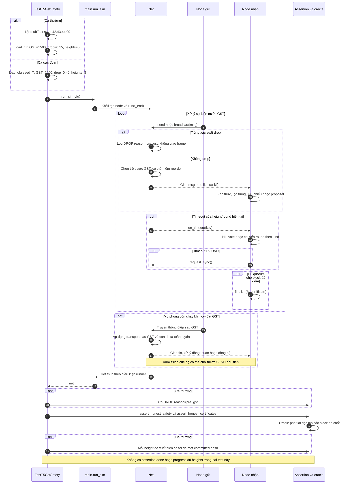

## T6 — Proposer im lặng và phục hồi round

Nguồn: [test_t6_silent_proposer.py](../Workspace/tests/e2e/test_t6_silent_proposer.py).

**Test method:**

- `test_t6_single_silent_proposer_round_advancement`
- `test_t6_three_silent_validators_liveness_preserved`

**Thiết lập:** Ca một node: V1=Silent(all), seed=42. Ca ba node: V1/V4/V7=Silent(all), seed=10. n=10, f=3, Q=7, mục tiêu 5 height.

**Điểm cần đọc đúng:** TIMEOUT PROPOSE làm cast PREVOTE NIL, không trực tiếp start_round(1). Chuyển round qua PRECOMMIT timeout, ROUND timeout hoặc cơ chế skip. Assertion chính xác round=1/proposer=V2 chỉ nằm ở ca một node.

[Mermaid](sequence-diagrams/t6-silent-proposer.mmd) · [SVG](sequence-diagrams/t6-silent-proposer.svg) · [PNG](sequence-diagrams/t6-silent-proposer.png)

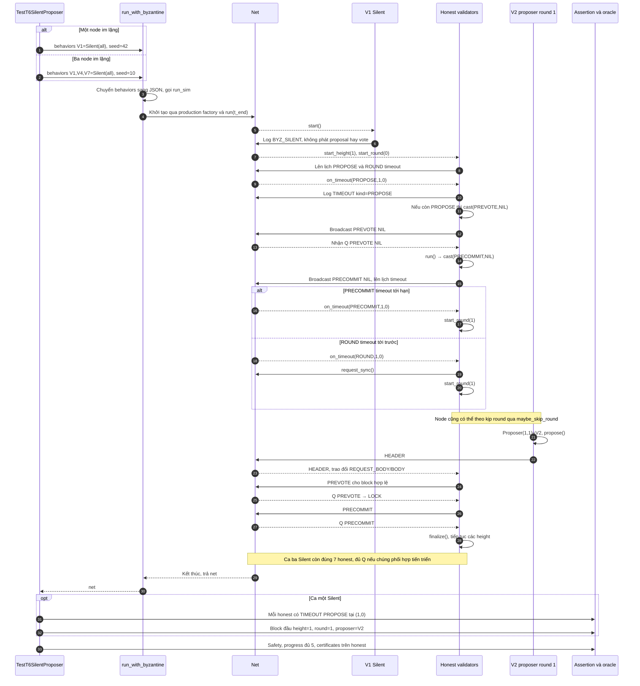

## T7a — Proposer đưa hai đề xuất

Nguồn: [test_t7_equivocation.py](../Workspace/tests/e2e/test_t7_equivocation.py).

**Test method:**

- `test_t7_equivocating_proposer_broadcast`
- `test_t7_equivocating_proposer_partitioned`

**Thiết lập:** V1=EquivocateProposer(height=1), seed=42. Ca broadcast không đặt groups; ca chia nhóm dùng [0,2,4,6] và [3,5,7,8].

**Điểm cần đọc đúng:** Chia nhóm ở đây là chọn người nhận proposal, không cắt liên kết mạng. Hai block A rỗng, B chứa một giao dịch hợp lệ. Không cố định block thắng hoặc round chốt. Trong chế độ groups, ByzantineBase không tự on_proposal như nhánh broadcast.

[Mermaid](sequence-diagrams/t7a-proposer-equivocation.mmd) · [SVG](sequence-diagrams/t7a-proposer-equivocation.svg) · [PNG](sequence-diagrams/t7a-proposer-equivocation.png)

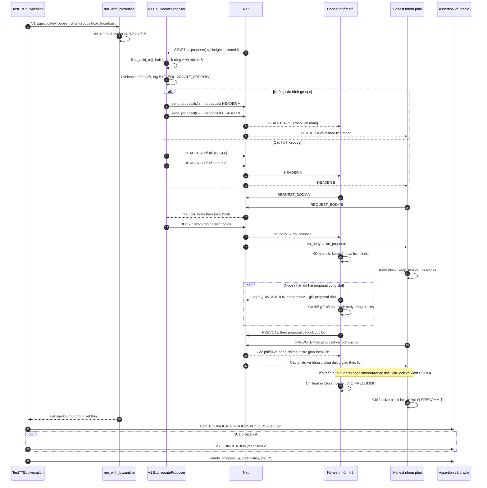

## T7b — Tối đa f voter ký hai mặt

Nguồn: [test_t7_equivocation.py](../Workspace/tests/e2e/test_t7_equivocation.py).

**Test method:**

- `test_t7_up_to_f_equivocating_voters`

**Thiết lập:** V3/V5/V7=EquivocateVoter mặc định, seed=42; attack slot mặc định height=1, round=0; targets mặc định=(target,NIL).

**Điểm cần đọc đúng:** Không vẽ mặc định là hai block A/B: targets mặc định là target và NIL. Nếu target đã là NIL thì a==b và hook gọi super().cast(). Nhánh phát hiện equivocation tùy thứ tự giao phiếu; assertion yêu cầu có ít nhất một log cho mỗi Byzantine.

[Mermaid](sequence-diagrams/t7b-voter-equivocation.mmd) · [SVG](sequence-diagrams/t7b-voter-equivocation.svg) · [PNG](sequence-diagrams/t7b-voter-equivocation.png)

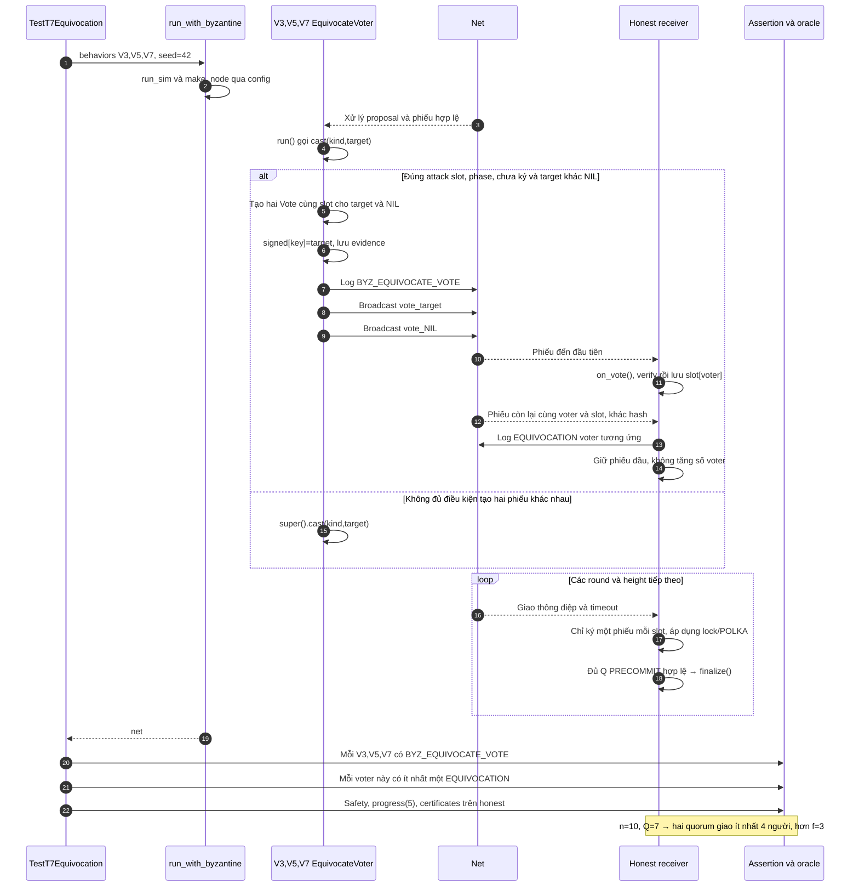

## T7c — Kết hợp proposer và voter Byzantine

Nguồn: [test_t7_equivocation.py](../Workspace/tests/e2e/test_t7_equivocation.py).

**Test method:**

- `test_t7_coalition_proposer_and_voters`

**Thiết lập:** seed=42; V1=EquivocateProposer(groups=[0,2,3]/[5,6,8],height=1); V4/V7=EquivocateVoter; tổng 3 Byzantine.

**Điểm cần đọc đúng:** Ca này dùng các lớp EquivocateProposer và EquivocateVoter, không dùng lớp ForkCoalition hay Coalition. Test không assert log tấn công riêng, chỉ assert safety/progress/certificates. Nhánh voter tấn công chỉ phát sinh khi cast() thỏa điều kiện.

[Mermaid](sequence-diagrams/t7c-mixed-coalition.mmd) · [SVG](sequence-diagrams/t7c-mixed-coalition.svg) · [PNG](sequence-diagrams/t7c-mixed-coalition.png)

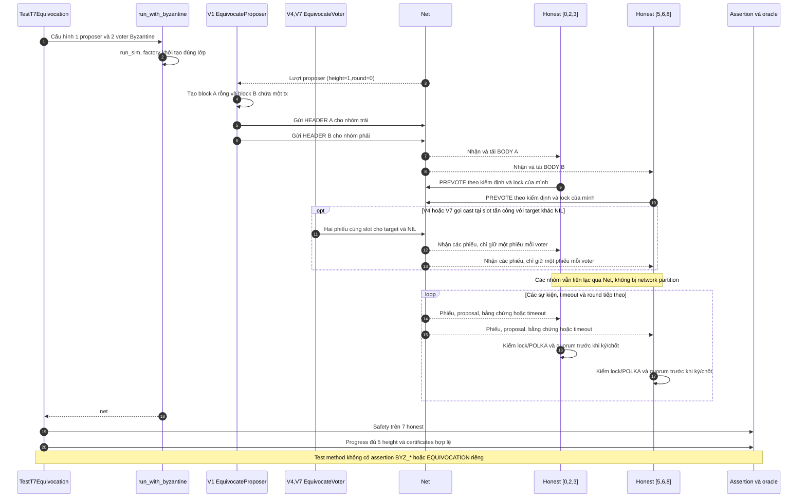

## T8a — Hai lần chạy cùng đầu vào

Nguồn: [test_t8_determinism.py](../Workspace/tests/e2e/test_t8_determinism.py).

**Test method:**

- `test_t8_default_config_rerun_twice`
- `test_t8_multiple_arbitrary_seeds`
- `test_t8_chaotic_pre_gst_network_determinism`
- `test_t8_byzantine_adversary_determinism`

**Thiết lập:** Mặc định seed=42; nhiều seed=1/99/1337 với heights=3; mạng nhiễu seed=77,GST=400,max_delay=80,drop=0.1,reorder=0.15,heights=4; Byzantine seed=123,heights=3,V1 EquivocateProposer,V4 Silent.

**Điểm cần đọc đúng:** Mỗi ca chạy hai mạng mới với cùng cấu hình và danh tính cố định. Không yêu cầu các seed khác nhau tạo cùng log. T8 xác nhận các ví dụ cụ thể, không phải chứng minh tất định cho mọi môi trường hay đầu vào.

[Mermaid](sequence-diagrams/t8a-two-runs.mmd) · [SVG](sequence-diagrams/t8a-two-runs.svg) · [PNG](sequence-diagrams/t8a-two-runs.png)

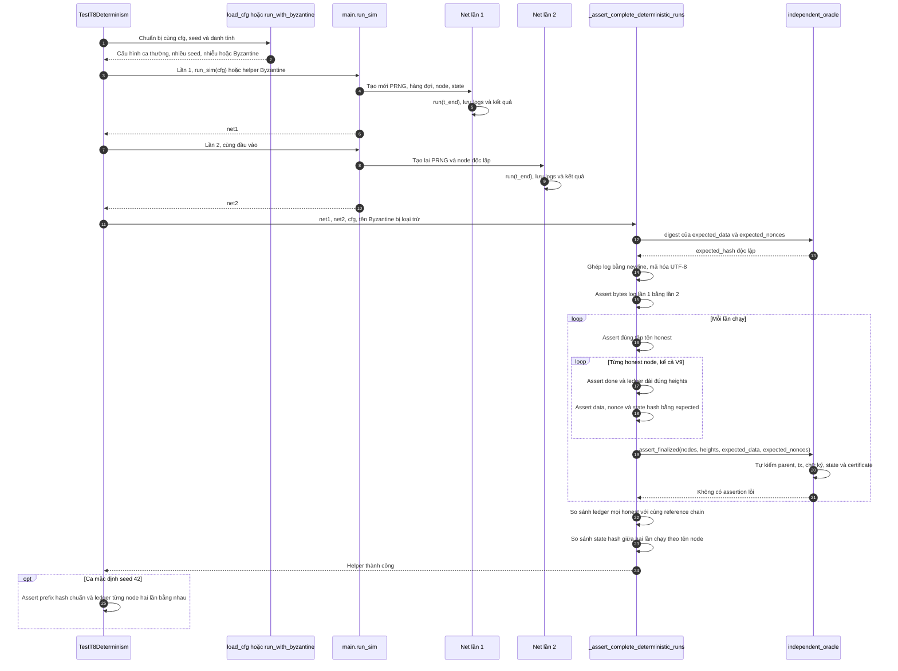

## T8b — Không chấp nhận hai lần cùng bị kẹt

Nguồn: [test_t8_determinism.py](../Workspace/tests/e2e/test_t8_determinism.py).

**Test method:**

- `test_t8_rejects_identically_incomplete_runs`

**Thiết lập:** t_end=0, heights=1, accounts=[Alice], txs_per_account=1.

**Điểm cần đọc đúng:** Test PASS khi helper ném AssertionError chứa did not finish. Không phải hai mô phỏng bị kẹt được xem là chạy đúng.

[Mermaid](sequence-diagrams/t8b-incomplete-negative-control.mmd) · [SVG](sequence-diagrams/t8b-incomplete-negative-control.svg) · [PNG](sequence-diagrams/t8b-incomplete-negative-control.png)

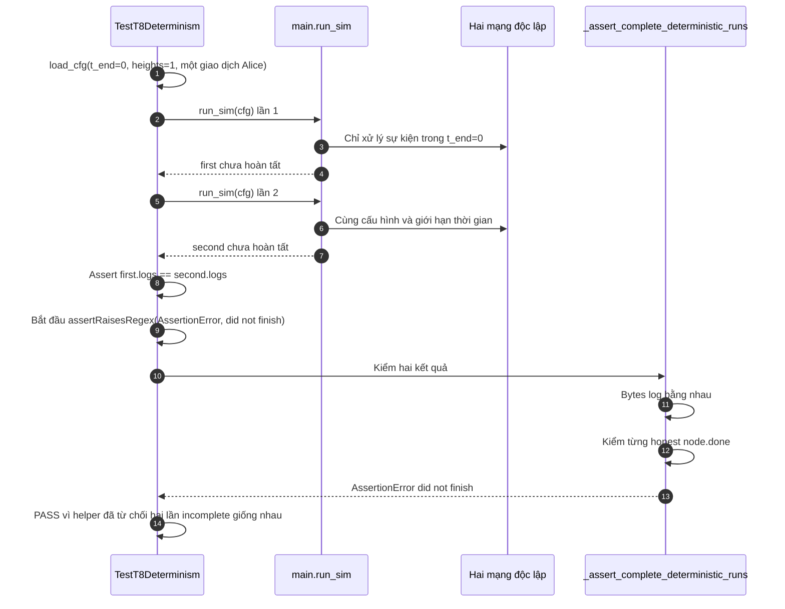

## T8c — Phát hiện lỗi riêng trên V9

Nguồn: [test_t8_determinism.py](../Workspace/tests/e2e/test_t8_determinism.py).

**Test method:**

- `test_t8_checks_every_honest_node_not_just_node_zero`

**Thiết lập:** GST=0, delta=1, heights=1, accounts=[Alice], txs_per_account=1; tắt duplicate/rate_limit/peer_block. Chỉ sửa kết quả lần 2 ở V9.

**Điểm cần đọc đúng:** Năm corruption được áp dụng tách biệt bằng mock.patch.object và khôi phục sau mỗi subtest. Không thay log hoặc V0. Test chứng minh helper không chỉ kiểm node đầu tiên.

[Mermaid](sequence-diagrams/t8c-every-node-negative-control.mmd) · [SVG](sequence-diagrams/t8c-every-node-negative-control.svg) · [PNG](sequence-diagrams/t8c-every-node-negative-control.png)

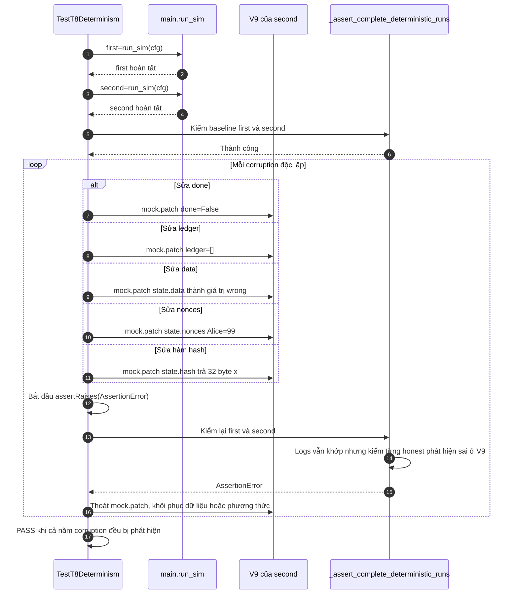

## Liên hệ với triển khai

- [main.py](../Workspace/src/main.py): kiểm cấu hình, nạp khóa, tạo node/mạng, admission giao dịch nền và `net.run(t_end)`.
- [node.py](../Workspace/src/node.py): các handler TX/HEADER/BODY/VOTE/SYNC, cơ chế signed/locked/proofs, timeout và finalize.
- [sim.py](../Workspace/src/sim.py): hàng đợi sự kiện, định tuyến, drop/reorder/duplicate và admission/rate limit.
- [byzantine.py](../Workspace/src/byzantine.py): Silent, EquivocateProposer, EquivocateVoter và Replay.
- [c_helpers.py](../Workspace/tests/c_helpers.py): config, RecordingNet, factory wrapper, safety/progress/certificate assertions.
- [independent_oracle.py](../Workspace/tests/independent_oracle.py): mã hóa/hash/xác thực và phát lại giao dịch độc lập với production.

Giao điểm quorum giải thích vì sao không được tùy tiện hạ ngưỡng phiếu. Safety xuyên nhiều round còn dựa vào quy tắc khóa, bằng chứng POLKA và xác thực; chỉ nêu Q lớn hơn n/2 chưa đủ để giải thích toàn bộ giao thức.

T3 unit guards trong `tests/unit/test_t3_signatures.py` được mô tả ở tài liệu kiểm thử; bộ sequence này tập trung T3 E2E hiện tại. Các suite regression, quorum-boundary và catch-up riêng không được gộp vào T1–T8 khi không được các test method ở đây gọi.
